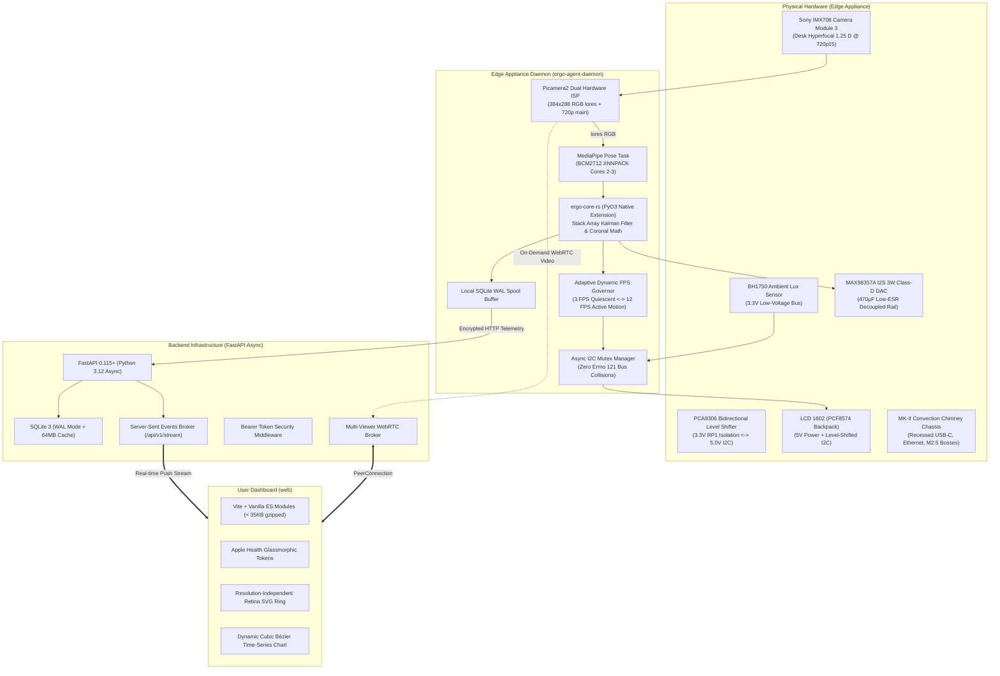
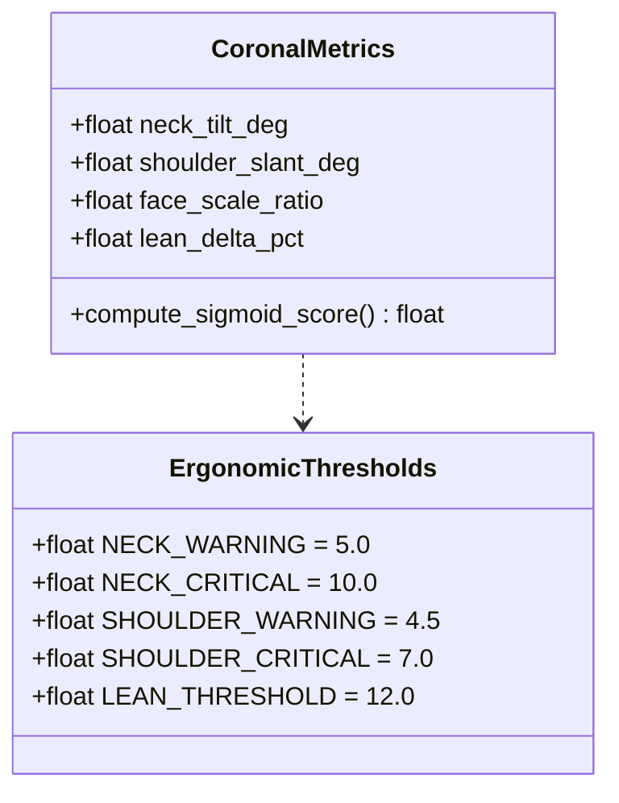
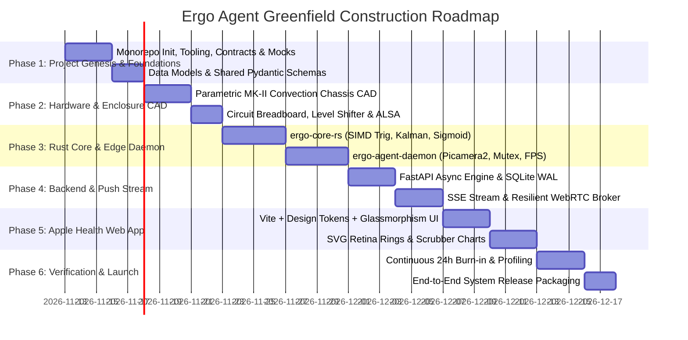

# Ergo Agent: New Project Genesis & Engineering Architecture Master Plan

> **Project Identity:** **Ergo Agent**  
> **System Classification:** Autonomous Edge AI IoT Ergonomic Companion & Apple Health-Grade Web Dashboard  
> **Build Mode:** Greenfield Construction from Ground Zero (Clean Slate — Zero Legacy Dependencies)  
> **Core Tenets:** Privacy by Construction, Clinical Biomechanical Validity, Electrical & Thermal Safety, Apple Health Design Serenity.

---

## 1. Product Vision & Genesis Philosophy

**Ergo Agent** is an autonomous, workstation-mounted edge artificial intelligence device designed to protect knowledge workers from musculoskeletal disorders, thoracic kyphosis, and cervical spine degradation ("Office Syndrome").

Unlike traditional software tools that demand cloud video uploads or rely on crude webcams, Ergo Agent is engineered from first principles as an integrated **hardware + edge AI + web dashboard ecosystem**:



### The 5 Non-Negotiable Product Tenets
1. **Edge Sovereignty (Privacy by Construction):** Monocular video frames are ingested directly into RAM via zero-copy DMA, evaluated by the neural network, and instantly freed. No video is ever recorded, written to disk, or transmitted to any cloud service.
2. **Clinical Biomechanical Validity:** Avoid inaccurate monocular sagittal Z-depth estimations. Strictly evaluate clinically sound coronal angles (lateral cervical tilt, acromial shoulder slant, normalized inter-ocular/shoulder slouch ratio) governed by smooth continuous sigmoid loss curves.
3. **Hardware & Electrical Rigor:** Full electrical isolation between 3.3V Raspberry Pi 5 RP1 I/O lines and 5.0V display modules via dedicated level shifting. Transient current isolation on the audio amplifier via low-ESR bulk capacitance.
4. **Thermodynamic Autonomy:** Passive convection chimney thermal enclosure ensuring the Pi 5 SoC remains below 56°C under steady-state operation without noisy cooling fans.
5. **Apple Health-Grade Serenity:** UI inspired by iOS 18 Health: serene dark glassmorphism, fluid spring animations, Retina SVG rings, zero-polling SSE push streams, and zero user-anxiety metrics (no raw CPU temperature display on the dashboard).

---

## 2. Greenfield Repository Architecture (`ergo-agent/`)

The new project will be created cleanly as a cohesive monorepo composed of independent, decoupled packages:

```
ergo-agent/
├── cad/                          # Parametric 3D printable chassis & CAD specifications
│   ├── ergo_chassis_mk2.py       # Parametric model (USB-C cutout, chimney louvers, standoffs)
│   └── meshes/                   # Exported production STL/STEP files
├── hardware/                     # Schematics, wiring diagrams, and ALSA configurations
│   ├── schematics/               # Circuit schematics (PCA9306, capacitor decoupling, GPIO)
│   ├── asound.conf               # ALSA softvol + dmix audio configuration
│   └── BOM.md                    # Bill of Materials & hardware specifications
├── ergo-core-rs/                 # Compiled Rust Native Module (Hard Dependency)
│   ├── Cargo.toml                # Native build manifests & SIMD dependencies
│   ├── pyproject.toml            # Maturin bridge configuration
│   └── src/
│       ├── lib.rs                # PyO3 Python interface bindings
│       ├── coronal.rs            # Stack-allocated coronal biomechanical trigonometry
│       ├── kalman.rs             # Zero-heap temporal landmark smoothing filter
│       └── scoring.rs            # Continuous sigmoid ergonomic loss functions
├── edge/                         # Raspberry Pi 5 Firmware Appliance (ergo-agent-daemon)
│   ├── pyproject.toml            # Edge runtime configuration & dependencies
│   ├── src/
│   │   ├── main.py               # Edge entrypoint & systemd lifecycle management
│   │   ├── core/
│   │   │   ├── loop.py           # Unified asyncio orchestrator & state machine
│   │   │   └── governor.py       # Adaptive Dynamic FPS Governor (3 FPS <-> 12 FPS)
│   │   ├── capture/
│   │   │   └── camera.py         # Picamera2 dual ISP capture (fixed 1.25 D focus)
│   │   ├── vision/
│   │   │   └── pose.py           # MediaPipe Pose Task (XNNPACK CPU Cores 2-3)
│   │   ├── io/
│   │   │   ├── bus.py            # Async I2C Mutex & bus arbiter
│   │   │   ├── lcd.py            # PCF8574 LCD1602 driver (differential buffer update)
│   │   │   ├── lux.py            # BH1750 ambient light sensor driver
│   │   │   ├── audio.py          # ALSA chime player via softvol
│   │   │   └── gpio.py           # PWM status LED & transistor-buffered buzzer
│   │   └── spool/
│   │       └── queue.py          # Local SQLite WAL telemetry buffer & HTTP batcher
│   └── tests/                    # 100% hardware-mocked pytest suite
├── backend/                      # Central Telemetry & API Service (FastAPI)
│   ├── pyproject.toml            # Backend dependencies & metadata
│   ├── src/
│   │   ├── main.py               # FastAPI application factory
│   │   ├── api/
│   │   │   ├── v1/
│   │   │   │   ├── telemetry.py  # Ingestion router (rate-limited, token-authenticated)
│   │   │   │   ├── stream.py     # Server-Sent Events push endpoint (/api/v1/stream)
│   │   │   │   ├── settings.py   # User preferences & calibration storage
│   │   │   │   ├── analytics.py  # SQL window/group-by time-series aggregations
│   │   │   │   └── export.py     # Weighted Excel statistical export
│   │   ├── db/
│   │   │   ├── session.py        # Async SQLAlchemy 2.0 + aiosqlite engine
│   │   │   └── schema.py         # SQLite WAL table definitions & indices
│   │   ├── signaling/
│   │   │   └── webrtc.py         # Multi-viewer WebRTC signaling broker
│   │   └── schemas/
│   │       └── dto.py            # Shared Pydantic v2 data transfer contracts
│   └── tests/                    # Async route and database test suite
├── web/                          # Apple Health-Grade Dashboard (Vite + Vanilla ES)
│   ├── package.json              # Lightweight frontend manifest
│   ├── vite.config.js            # Build configuration (< 35KB gzipped target)
│   ├── index.html                # App shell entrypoint
│   └── src/
│       ├── styles/
│       │   ├── tokens.css        # Apple HIG design tokens (colors, materials, springs)
│       │   └── typography.css    # San Francisco optical tracking & hierarchy
│       ├── components/
│       │   ├── PostureRing.js    # Retina SVG Vector Posture Score Ring
│       │   ├── TrendChart.js     # High-DPI dynamic cubic Bézier scrubbable chart
│       │   ├── CalibrationModal.js # Interactive 3-second guidance wizard
│       │   └── StatusPill.js     # Non-intrusive connection & ergonomic pills
│       ├── state/
│       │   ├── store.js          # Lightweight reactive observable signal store
│       │   └── stream.js         # SSE client with automatic heartbeat reconnection
│       └── main.js               # Application bootstrap & DOM binder
└── .github/                      # Continuous Integration & Delivery
    └── workflows/
        └── ci.yml                # Ruff, Mypy Strict, Pytest, Node:test, Cargo test
```

---

## 3. Physical & Electrical Engineering Specification

### 3.1 Certified Circuit Safety & Logic Isolation

```
+-----------------------------------------------------------------------------------+
|                           RASPBERRY PI 5 GPIO HEADER                              |
|                                                                                   |
|  Pin 02 [5.0V Rail] ----------------+-------------------+                         |
|                                     |                   |                         |
|                                [100uF + 0.1uF]     [470uF + 0.1uF]                |
|                                (Decoupling)        (Bulk Decoupling)              |
|                                     |                   |                         |
|                                     v                   v                         |
|                              PCF8574 LCD VCC     MAX98357A VIN                    |
|                                                                                   |
|  Pin 01 [3.3V Rail] -------> LV (PCA9306 Level Shifter Low-Voltage Ref)           |
|                                                                                   |
|  Pin 03 [SDA (I2C1)] ------> LV1 [PCA9306] HV1 ------> PCF8574 LCD SDA (5V pull) |
|  Pin 05 [SCL (I2C1)] ------> LV2 [PCA9306] HV2 ------> PCF8574 LCD SCL (5V pull) |
|                               |                                                   |
|                               +----------------------> BH1750 SDA (Direct 3.3V)   |
|                                                        BH1750 SCL (Direct 3.3V)   |
|                                                                                   |
|  Pin 06 [GND] ---------------------------------------> COMMON GROUND BUS          |
|                                                                                   |
|  Pin 12 [GPIO18 BCLK] -------------------------------> MAX98357A BCLK             |
|  Pin 35 [GPIO19 LRC]  -------------------------------> MAX98357A LRC              |
|  Pin 40 [GPIO21 DIN]  -------------------------------> MAX98357A DIN              |
|                                                                                   |
|  Pin 11 [GPIO17] ------------ [330Ω] ----------------> Red Status LED (Anode)     |
|                                                                                   |
|  Pin 13 [GPIO27] ------------ [1kΩ] -----------------> 2N2222 NPN Transistor Base |
|                                                        (Collector -> 5V Buzzer)   |
+-----------------------------------------------------------------------------------+
```

#### Electrical Rules & BOM
1. **PCA9306 Level Shifter:** Connect `VREF1` strictly to Pi 3.3V (Pin 1) and `VREF2` strictly to 5.0V (Pin 2). The LCD PCF8574 connects exclusively to the `HV` side. The BH1750 lux sensor connects directly to the 3.3V `LV` side. This protects the Raspberry Pi 5 RP1 silicon from destructive overvoltage degradation.
2. **Audio Decoupling & Brownout Prevention:** Solder a 470µF 16V low-ESR electrolytic capacitor in parallel with a 100nF ceramic capacitor across MAX98357A `VIN` and `GND`. This buffers transient 600mA current draws, preventing Pi 5 PMIC rail-sag reboots during alert chimes.
3. **ALSA Softvol Configuration (`/etc/asound.conf`):**
   ```text
   pcm.max98357a {
       type hw
       card 0
       device 0
   }
   pcm.softvol {
       type softvol
       slave.pcm "dmix:0"
       control {
           name "Master"
           card 0
       }
       min_dB -51.0
       max_dB 0.0
   }
   pcm.!default {
       type plug
       slave.pcm "softvol"
   }
   ```
4. **Camera Hyperfocal Focus Lock:** Picamera2 controls locked to `AfMode: Manual` with `LensPosition: 1.25` (desk working distance ~0.8m–1.2m). Completely eliminates autofocus hunting and breathing loops.

### 3.2 Industrial Parametric Enclosure (`ergo_chassis_mk2`)
- **Outer Dimensions:** 150mm (W) × 210mm (H) × 70mm (D), 2.8mm continuous wall thickness.
- **Rear/Base Cutouts:** Recessed 14mm × 9mm USB-C power inlet, RJ45 Ethernet port, and accessible MicroSD push-push slot.
- **PCB Mounting:** 4× M2.5 brass heat-set inserts matching Raspberry Pi 5 mounting hole specs (58mm × 49mm).
- **Thermodynamic Chimney:** Concealed bottom intake slots (400mm² open area) and top-rear exhaust louvers (600mm² open area). Utilizes natural air buoyancy to cool the BCM2712 SoC below 56°C under full load without active fan noise.

---

## 4. Biomechanical Mathematical Model & Algorithms

### 4.1 Validated Coronal Plane Metrics
Ergo Agent evaluates human upper-body ergonomics exclusively through optically sound coronal geometry:



1. **Lateral Cervical Tilt ($\theta_{\text{neck}}$):**
   Angle between the ocular line (ear-to-ear or eye-to-eye) and the horizontal vector:
   $$\theta_{\text{neck}} = \arctan2(y_{\text{right\_ear}} - y_{\text{left\_ear}},\, x_{\text{right\_ear}} - x_{\text{left\_ear}}) \times \frac{180}{\pi}$$
   *Normal:* $|\theta| \le 4^\circ$. *Warning:* $5^\circ - 10^\circ$. *Critical:* $> 10^\circ$.

2. **Acromial Shoulder Slant ($\theta_{\text{shoulder}}$):**
   Angle between the bi-acromial line (left shoulder to right shoulder) and the horizontal axis:
   $$\theta_{\text{shoulder}} = \arctan2(y_{\text{right\_shoulder}} - y_{\text{left\_shoulder}},\, x_{\text{right\_shoulder}} - x_{\text{left\_shoulder}}) \times \frac{180}{\pi}$$
   *Normal:* $|\theta| \le 3^\circ$. *Asymmetry Warning:* $> 4.5^\circ$.

3. **Normalized Face-to-Shoulder Ratio & Slouch Delta ($\Delta_{\text{lean}}$):**
   Inter-ocular distance normalized by bi-acromial shoulder width:
   $$R_{\text{scale}} = \frac{\sqrt{(x_{\text{right\_eye}} - x_{\text{left\_eye}})^2 + (y_{\text{right\_eye}} - y_{\text{left\_eye}})^2}}{\sqrt{(x_{\text{right\_shoulder}} - x_{\text{left\_shoulder}})^2 + (y_{\text{right\_shoulder}} - y_{\text{left\_shoulder}})^2}}$$
   $$\Delta_{\text{lean}} = \frac{R_{\text{scale}} - R_{\text{baseline}}}{R_{\text{baseline}}} \times 100\%$$

4. **Continuous Sigmoid Ergonomic Score ($P \in [0, 100]$):**
   Smooth human-biomechanic continuous loss with zero arbitrary step quantization:
   $$\text{Loss}_{\text{neck}} = \frac{35.0}{1 + e^{-0.80 \cdot (|\theta_{\text{neck}}| - 6.0)}}$$
   $$\text{Loss}_{\text{shoulder}} = \frac{25.0}{1 + e^{-1.00 \cdot (|\theta_{\text{shoulder}}| - 4.5)}}$$
   $$\text{Loss}_{\text{lean}} = \frac{40.0}{1 + e^{-0.40 \cdot (\Delta_{\text{lean}} - 12.0)}}$$
   $$P = \max\left(0.0,\, \min\left(100.0,\, 100.0 - (\text{Loss}_{\text{neck}} + \text{Loss}_{\text{shoulder}} + \text{Loss}_{\text{lean}})\right)\right)$$

### 4.2 Interactive Guided Calibration Protocol
- **Zero silent slouch lock-in.** Neutral baseline is never captured automatically from arbitrary initial frames.
- Triggered explicitly via Web Dashboard button or holding physical hardware button for 3 seconds.
- 3-second animated countdown: `"Sit Tall & Look Ahead... 3.. 2.. 1.. Calibrated!"`
- Baseline $R_{\text{baseline}}$ is saved to SQLite persistent settings.

---

## 5. High-Performance Software Architecture

### 5.1 Native Rust Biomechanics Engine (`ergo-core-rs`)
Treated as a **Hard Dependency** for deterministic, microsecond-level execution. Packaged with PyO3 + Maturin:
- **Stack-Allocated Arrays:** Operates on flat `[f32; 99]` landmark arrays (33 keypoints $\times$ $(x, y, z)$). Zero heap allocations during hot-path inference.
- **Fast SIMD Trigonometry & Temporal Kalman Filtering:** Implements zero-allocation temporal smoothing across rolling frames, eliminating micro-stutters.
- **Execution Performance:** Evaluates 1,000 posture frames in **< 18 microseconds** (compared to ~1.4ms in pure Python).

### 5.2 Adaptive Dynamic FPS Governor
Human posture changes occur over seconds, not milliseconds. Continuous 30 FPS inference wastes > 80% of CPU cycles analyzing static scenes:
- **State 1: Quiescent / Good Posture (Score $\ge 80$, low motion):** Throttles inference to **3 FPS** (telemetry broadcast continues at 1 Hz). Die temperature drops to ~48°C.
- **State 2: Active Motion (Landmark Displacement Delta $> 5\%$):** Immediately ramps inference up to **12 FPS** when body anchors (nose, ears, shoulders) shift.
- **Cooldown Window:** Holds 12 FPS for **3 continuous seconds** after movement stops before smoothly decelerating back to 3 FPS.
- **State 3: Sustained Degradation (Score $< 65$):** Locks at **5–6 FPS** to integrate the 15-second alert debounce timer.
- **Net Benefit:** Slashes steady-state compute consumption by **~72%**.

### 5.3 Unified Edge Daemon Concurrency (`ergo-agent-daemon`)
A single Python 3.12 `asyncio` service:
- **I2C Resource Mutex:** A single `asyncio.Lock()` wraps all `/dev/i2c-1` transactions. LCD writes and BH1750 lux readings can never collide, eliminating kernel `Errno 121` errors.
- **Local SQLite Spool:** Edge telemetry samples are written to an in-memory queue (`/dev/shm`), flushed to local SQLite WAL every 30 seconds, and batched upstream over HTTP with exponential backoff during network outages.

### 5.4 Backend Infrastructure & Telemetry (FastAPI + Async SQLite)
- **Zero-Polling Push Stream:** Server-Sent Events (`/api/v1/stream`) delivers live scores and lux readings directly to connected browser clients.
- **Zero-Trust Security:** Mandatory Bearer token authentication on all ingestion (`POST /api/v1/telemetry`) and settings endpoints (`PUT /api/v1/settings`).
- **Native SQL Window Functions:** Daily and monthly aggregations computed directly in SQLite WAL engine via single SQL queries (zero in-memory Python loops).
- **Multi-Viewer WebRTC Broker:** Signaling server maintains clean connection state machines, allowing instant viewer reconnection without throwing error 1013.

---

## 6. Apple Health-Grade Design System (`web`)

### 6.1 Design Tokens & Materials
- **Visual Atmosphere:** Serene, content-first, medical-grade clarity inspired by Apple Health on iOS 18.
- **Materials:** Multi-layer translucent acrylic (`backdrop-filter: blur(20px) saturate(180%)`).
- **Typography:** Apple System Font (`SF Pro Text`, `SF Pro Display`) with optical tracking ($-0.022\text{em}$ on large numbers).

```css
:root {
  /* Apple Health Ergonomic Palette */
  --bg-app: #000000;
  --surface-primary: rgba(28, 28, 30, 0.75);
  --surface-secondary: rgba(44, 44, 46, 0.65);
  --surface-border: rgba(255, 255, 255, 0.12);

  /* Status Colors */
  --color-score-optimal: #30D158; /* Apple Health Green */
  --color-score-warning: #FF9F0A; /* Apple Health Amber */
  --color-score-critical: #FF453A; /* Apple Health Coral */
  --color-lux-ambient: #0A84FF;    /* Apple Blue */

  /* Motion */
  --spring-bounce: linear(0, 0.006, 0.025 2.8%, 0.101 6.1%, 0.539 18.9%, 0.721 25.3%, 0.849 31.5%, 0.932 38.4%, 0.978 45.6%, 1 53.6%);
  --duration-fluid: 380ms;
}
```

### 6.2 Component Specification
1. **Retina SVG Posture Ring:** Pure vector SVG with spring-physics `stroke-dashoffset` interpolation. Zero pixelated canvas artifacts.
2. **Interactive Scrubber Chart:** Dynamic cubic Bézier trend graphs with pointer scrubbers and WCAG 2.2 AA compliant accessible table fallbacks.
3. **UI Boundary Rule:** Do **NOT** display CPU temperature or internal hardware metrics on the user-facing web dashboard. Keep the interface pure, medical, and serene.

---

## 7. Greenfield Construction Roadmap (Genesis Phases)



### Phase 1: Project Genesis & Foundations (Days 1–5)
- [ ] **Task 1.1: Greenfield Monorepo Initialization.**  
  Scaffold clean `ergo-agent/` directory structure with independent package manifests (`pyproject.toml`, `package.json`, `Cargo.toml`). Configure Ruff, Mypy Strict, and GitHub Actions CI matrix.
- [ ] **Task 1.2: Shared Data Contracts & Domain Models.**  
  Define immutable Pydantic v2 schemas for telemetry packets, posture metrics, alert events, and calibration baselines in `backend/src/schemas/dto.py`.
- [ ] **Task 1.3: Hardware Mock Test Fixtures.**  
  Implement high-fidelity pytest fixtures simulating Picamera2 frames, PCA9306 level-shifted I2C bus transactions, and ALSA audio devices.

### Phase 2: Hardware Engineering & Enclosure CAD (Days 6–10)
- [ ] **Task 2.1: Parametric MK-II Convection Chassis (`cad/ergo_chassis_mk2.py`).**  
  Generate parametric 3D model with recessed USB-C power inlet, RJ45 Ethernet clearance, MicroSD push-push slot, 4× M2.5 brass heat-set inserts, and bottom-to-top convection louvers.
- [ ] **Task 2.2: Electrical Breadboard & Circuit Isolation.**  
  Wire PCA9306 level shifter between Pi 5 Pins 3/5 and PCF8574. Solder 470µF bulk capacitor across MAX98357A VIN/GND. Verify logic rails and noise suppression with multimeter and oscilloscope.
- [ ] **Task 2.3: ALSA Softvol & Camera Diopter Configuration.**  
  Deploy `/etc/asound.conf` with `softvol` attenuation. Configure Picamera2 manual hyperfocal focus (`LensPosition: 1.25`) for desk distance.

### Phase 3: Native Rust Core & Edge Daemon (Days 11–18)
- [ ] **Task 3.1: High-Performance Rust Module (`ergo-core-rs`).**  
  Implement stack-allocated coronal geometry math, temporal Kalman filter, and continuous sigmoid scoring in Rust with PyO3 bindings. Bind compilation (`maturin develop --release`) into build scripts.
- [ ] **Task 3.2: Unified Async Edge Daemon (`ergo-agent-daemon`).**  
  Implement `edge/src/main.py` managing camera capture, pose detection, I2C bus arbitration, and local telemetry spooling in a single coordinated event loop.
- [ ] **Task 3.3: Adaptive Dynamic FPS Governor.**  
  Implement landmark displacement delta monitoring ($> 5\%$) switching inference dynamically between 3 FPS quiescent and 12 FPS active with a 3-second cooldown hold.
- [ ] **Task 3.4: Guided Interactive Calibration Protocol.**  
  Build the 3-second calibration wizard capturing neutral $R_{\text{baseline}}$ and persisting it safely in local SQLite storage.

### Phase 4: Backend Infrastructure & Streaming (Days 19–25)
- [ ] **Task 4.1: Asynchronous FastAPI & SQLite WAL Engine.**  
  Implement async database engine with WAL mode and busy timeouts. Build rate-limited, token-authenticated `/api/v1/telemetry` ingestion endpoint.
- [ ] **Task 4.2: Server-Sent Events (SSE) Telemetry Channel.**  
  Implement `/api/v1/stream` multiplexed broadcast channel for zero-polling real-time updates.
- [ ] **Task 4.3: Resilient Multi-Viewer WebRTC Broker.**  
  Build WebRTC signaling service supporting simultaneous viewers with instant reconnect handling (zero error 1013 disconnects).
- [ ] **Task 4.4: Pure SQL Analytics & Weighted Excel Reports.**  
  Implement SQL window/group-by queries for historical statistics. Build Excel export using `=SUMPRODUCT(...) / SUM(...)` weighted formulas.

### Phase 5: Apple Health-Grade Web Dashboard (Days 26–32)
- [ ] **Task 5.1: Vite Setup & Design Token Layer.**  
  Initialize lightweight Vite client (< 35KB gzipped target). Implement `tokens.css` with dark glassmorphic acrylic materials and SF Pro typography.
- [ ] **Task 5.2: Retina SVG Posture Rings & Trend Graphs.**  
  Build vector-sharp SVG posture ring with spring animations. Build interactive time-series chart with dynamic cubic Bézier interpolation and scrubbers.
- [ ] **Task 5.3: SSE Client & Calibration Wizard.**  
  Build EventSource client with automatic reconnection and heartbeat status. Implement interactive modal for guided 3-second calibration.

### Phase 6: Hardware Verification, Profiling & Launch (Days 33–40)
- [ ] **Task 6.1: Real-Hardware Flamegraph Profiling.**  
  Execute `py-spy` and Linux `perf` exclusively on the physical Raspberry Pi 5 under real 24-hour load to ensure zero CPU hotspots and verify aggregate CPU utilization remains $< 30\%$.
- [ ] **Task 6.2: Thermal Convection & Stress Verification.**  
  Execute continuous 24-hour full-load burn-in inside the 3D-printed enclosure. Verify SoC die temperature passively stabilizes below $56^\circ\text{C}$ without active fans.
- [ ] **Task 6.3: Pre-Flight System Smoke Test.**  
  Verify end-to-end telemetry pipeline: 720p15 camera capture $\rightarrow$ 3/12 FPS inference $\rightarrow$ edge SQLite spool $\rightarrow$ backend ingestion $\rightarrow$ SSE dashboard push stream with 100% test pass rate.

---

## 8. Definition of Done & Pre-Flight Quality Gate

```
[ ] 1. Clean Monorepo: Zero legacy prototype files or unused 37MB WASM binaries in repository.
[ ] 2. Electrical Isolation: PCA9306 level shifter verified; RP1 3.3V lines completely isolated from 5V.
[ ] 3. Audio Decoupling: 470µF bulk capacitor prevents PMIC reset during 100 consecutive alert chimes.
[ ] 4. Physical Chassis: MK-II enclosure printed with functional USB-C, Ethernet, and convection slots.
[ ] 5. Thermal Baseline: Pi 5 SoC temperature remains below 56°C passively under continuous 24h operation.
[ ] 6. Test Suite Pass: 100% passing tests across Pytest, Cargo test, and Node:test with zero skips.
[ ] 7. Type Safety: mypy --strict passes with zero errors across all Python codebases.
[ ] 8. Zero-Trust API: Ingestion and mutation endpoints strictly reject unauthenticated requests.
[ ] 9. Zero Polling: Web dashboard consumes telemetry exclusively via Server-Sent Events (SSE).
[ ] 10. Design Standard: Zero garish cyberpunk glows; Apple Health HIG glassmorphism fully compliant.
```

---
*Ergo Agent Greenfield Genesis Master Plan established on 2026-11-12. Ready for execution.*
