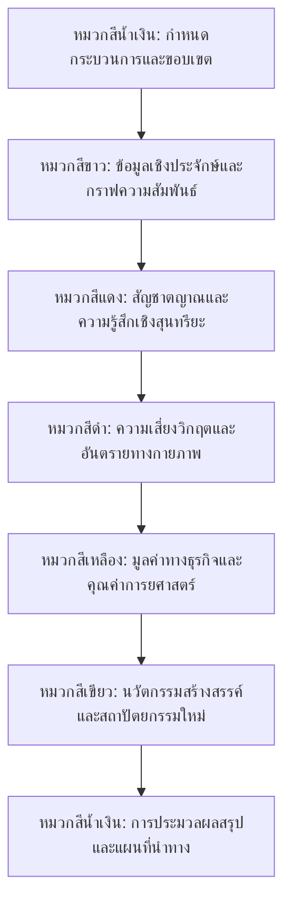
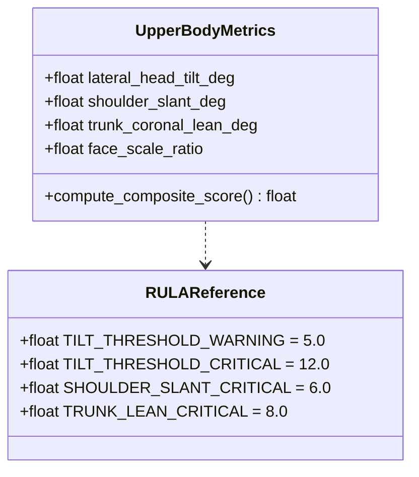
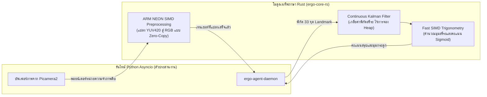
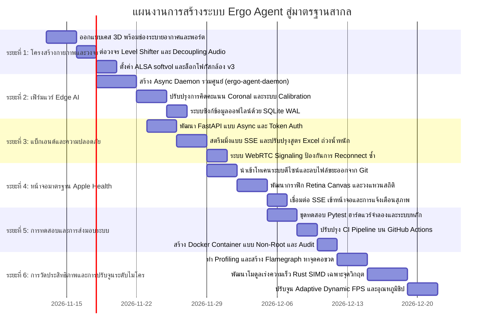

# Ergo Agent: แผนแม่บทวิศวกรรมการออกแบบและยกเครื่องระบบสู่ระดับ Production-Grade
*(Ergo Agent: Production-Grade Engineering & Redesign Master Plan — ฉบับภาษาไทย)*

> **สถานะสถาปัตยกรรม:** รื้อถอนและสร้างระบบใหม่ทั้งหมดจากข้อเท็จจริงเชิงประจักษ์ (Ground Truth) ภายใต้แบรนด์ **Ergo Agent**  
> **มาตรฐานเป้าหมาย:** ฮาร์ดแวร์ Edge AI IoT เกรดอุตสาหกรรม และแดชบอร์ดระดับ Apple Health  
> **ระเบียบวิธีที่นำมาบูรณาการ:** การคิดเชิงวิเคราะห์หมวก 6 ใบ (Six Thinking Hats), สถาปัตยกรรมโค้ดสะอาด (Clean Code: Robert C. Martin), มาตรฐานส่วนต่อประสานที่ลื่นไหลตามหลักสรีรศาสตร์ (Apple Fluid Interface & HIG), UI/UX Pro Max, มาตรฐานความประณีตระดับ Impeccable, และวิศวกรรมระบบสมรรถนะสูง (High-Performance Systems Architecture)

---

## 1. คำวินิจฉัยของผู้บริหารและการวิเคราะห์ด้วยหมวก 6 ใบ (The Six Thinking Hats Analysis)

### ประเด็นโฟกัสหลัก
> *"เราควรแก้ไขระบบเดิมแบบปะผุทีละจุด หรือควรรื้อสร้างใหม่หมดจากหลักการมูลฐาน (First Principles) ให้เป็นแพลตฟอร์มการยศาสตร์อัจฉริยะระดับ Production-Grade ในนาม Ergo Agent?"*



#### 🔵 หมวกสีน้ำเงิน (Blue Hat: กระบวนการและขอบเขต)
- **โหมดการทำงาน:** การประมวลผลเชิงวิเคราะห์และการตัดสินใจรอบด้าน (น้ำเงิน → ขาว → แดง → ดำ → เหลือง → เขียว → น้ำเงิน)
- **คำสั่งแกนหลัก:** แก้ไขข้อบกพร่องทุกประการ ทั้งทางด้านกายภาพ วงจรไฟฟ้า ชีวกลศาสตร์ ความปลอดภัย สถาปัตยกรรมซอฟต์แวร์ และงานออกแบบส่วนต่อประสาน ที่ถูกค้นพบในการชันสูตรโค้ด ([project_review.md](file:///C:/Users/101/Downloads/off/project_review.md)) และจาก Knowledge Graph ขนาด 1,660 โหนด ([graph.json](file:///C:/Users/101/Downloads/off/graphify-out/graph.json))

#### ⚪ หมวกสีขาว (White Hat: ข้อเท็จจริงและข้อมูลเชิงประจักษ์)
- `[ข้อเท็จจริง]` โค้ดเบสเดิมประกอบด้วย 96 ไฟล์ และประมาณ 117,775 คำ กระจายอยู่ใน 135 ชุมชนโมดูล
- `[ข้อเท็จจริง]` มีไฟล์ไบนารี WebAssembly ขนาดใหญ่กว่า 37 MB (`vision_wasm_internal.wasm`, `pose_landmarker_full.task`) ติดค้างอยู่ใน Git history ทั้งที่บอร์ด Raspberry Pi มีระบบรันโมเดล Edge AI ภายในตัวเอง
- `[ข้อเท็จจริง]` เทสต์เดิมใน `backend/tests/test_api.py` และ `raspberrypi/tests/test_config.py` ล้มเหลวทันทีหลัง Checkout เพราะค่าตั้งต้นไม่สอดคล้องกับ Logic ในตัวโค้ด
- `[ข้อเท็จจริง]` ระบบ CI ของ GitHub Actions ขาดแพ็กเกจ `httpx` และ `openpyxl` และไม่ได้ครอบคลุมการรันทดสอบฮาร์ดแวร์ทั้ง 67 รายการของฝั่ง Raspberry Pi
- `[ข้อเท็จจริง]` ไฟล์เคสพิมพ์ 3 มิติ (`build_print_case.py`) เดิมไม่มีช่องเจาะสำหรับเสียบสายไฟ USB-C, ไม่มีช่องพอร์ตเชื่อมต่อ, ไม่มีเสารองรับน็อตยึดบอร์ด Pi 5 และไม่มีช่องระบายอากาศเพื่อการพาความร้อน
- `[ข้อเท็จจริง]` บอร์ดแปลง I2C สำหรับจอ LCD (ชิป PCF8574) ดึงแรงดันสัญญาณ SDA/SCL ขึ้นไปที่ 5.0V ซึ่งเกินพิกัดความทนทาน 3.3V ของชิป I/O RP1 บน Raspberry Pi 5
- `[ข้อเท็จจริง]` มีโปรเซสอิสระ 2 ตัวเข้าถึงพอร์ต `/dev/i2c-1` พร้อมกันโดยไม่มีการล็อกบัส ทำให้เกิดความผิดพลาดระดับเคอร์เนล `Errno 121 (Remote I/O error)`
- `[ข้อเท็จจริง]` หน้าเว็บแดชบอร์ดใช้วิธี Polling ยิงเรียก API ทุก 500ms (4 ครั้ง/วินาที/แท็บ) สร้างโหลด 14,400 Requests/ชั่วโมง ต่อผู้ใช้ 1 หน้าต่าง สู่โปรเซส Uvicorn ตัวเดียว
- `[ข้อเท็จจริง]` มี API ที่ไม่มีการตรวจสอบสิทธิ์ เช่น `DELETE /api/data` และ `PUT /api/settings` เมื่อเปิดใช้งานค่าเริ่มต้น
- `[สมมติฐาน]` กล้องเว็บแคมเลนส์เดี่ยว 2 มิติที่ตั้งตรงหน้าโต๊ะทำงาน ไม่สามารถวัดระยะลึก (แกน Z) หรืออาการก้มหัวไปข้างหน้าได้อย่างแม่นยำ หากไม่มีการทำ Calibration หรือมาร์กเกอร์ช่วยระบุระยะ
- `[ไม่ทราบแน่ชัด]` ค่าระดับความดังของเสียงเตือนที่เหมาะสมในสภาพแวดล้อมสำนักงาน เพื่อไม่ให้ผู้ใช้งานเกิดความตกใจ

#### 🔴 หมวกสีแดง (Red Hat: สัญชาตญาณและความรู้สึก)
- **ความรู้สึกแรก:** ต้นแบบเดิมสร้างภาพลวงตาว่าเป็นเทคโนโลยี AI ล้ำสมัย แต่กลับล้มเหลวในมาตรฐานวิศวกรรมไฟฟ้าขั้นพื้นฐาน การส่งมอบกล่องเคสทึบที่ไม่มีแม้แต่รูเสียบสายไฟถือเป็นข้อผิดพลาดที่ยอมรับไม่ได้ในระดับมืออาชีพ
- **สุนทรียศาสตร์:** ธีม "Electric Navy Cyber-Medical" ที่มีแสงนีออนกระพริบ กรอบ HUD สไตล์ไซเบอร์พังก์ และแสงวาบสีฟ้า ทำให้ระบบดูเหมือนอุปกรณ์เสริมเกมราคาประหยัด มากกว่าจะเป็นอุปกรณ์การยศาสตร์ทางการแพทย์สำหรับองค์กร ก่อให้เกิดความล้าสายตาอย่างรวดเร็ว
- **ความโล่งใจ:** การล้างบางระบบ กำจัดไฟล์ไบนารีขยะ 37MB และรวมศูนย์บัสรับส่งข้อมูลเป็นหนึ่งเดียว จะทำให้ระบบมีความสง่างาม น่าเชื่อถือ และบำรุงรักษาง่ายขึ้นมหาศาล

#### ⚫ หมวกสีดำ (Black Hat: ความเสี่ยงวิกฤตและจุดล้มเหลว)
- **ความเสี่ยงที่ 1: ชิป RP1 บน Pi 5 พังทลายจากแรงดันเกิน (Overvoltage)**  
  *รูปแบบความล้มเหลว:* การต่อโมดูล I2C 5V เข้าขาพิน 3 และ 5 ของ Pi 5 โดยตรงจะทำลายไดโอดป้องกัน ESD ภายในตัวชิป  
  *แนวทางแก้ไข:* ต้องติดตั้งไอซีแปลงระดับสัญญาณตรรกะแบบสองทิศทาง (Logic Level Shifter) รุ่น PCA9306 หรือ BSS138 คั่นระหว่างพอร์ต 3.3V ของ Pi กับ 5.0V ของอุปกรณ์ภายนอก
- **ความเสี่ยงที่ 2: ไฟตกจนระบบรีเซ็ต (PMIC Brownout) ระหว่างส่งเสียงเตือน**  
  *รูปแบบความล้มเหลว:* โมดูลขยายเสียง MAX98357A (3W) ดึงกระแสกระชากชั่วขณะสูงถึง 600mA จากขา Pin 2 ทำให้แรงดันไฟเลี้ยง 5V ดรอปลงจนตัวจัดการพลังงานสั่งดับ  
  *แนวทางแก้ไข:* บัดกรีตัวเก็บประจุ Low-ESR ชนิดอิเล็กโทรไลต์ขนาด 470µF ขนานกับตัวเก็บประจุเซรามิก 0.1µF เข้าที่ขั้วไฟเลี้ยงของวงจรขยายเสียงโดยตรง
- **ความเสี่ยงที่ 3: เสียงดังกระแทกหูจนเกิด Acoustic Shock**  
  *รูปแบบความล้มเหลว:* การบายพาสตัวปรับระดับเสียงของระบบเสียง ALSA ทำให้เสียงเตือนถูกขยายที่กำลังขับสูงสุด +9dB โดยไม่สามารถลดเสียงได้  
  *แนวทางแก้ไข:* กำหนดค่าไฟล์คอนฟิก `/etc/asound.conf` ของ ALSA โดยใช้ปลั๊กอิน `softvol` ควบคู่กับตัวผสมสัญญาณ `dmix`
- **ความเสี่ยงที่ 4: การแจ้งเตือนท่านั่งผิดพลาดซ้ำซาก (False Positive Fatigue)**  
  *รูปแบบความล้มเหลว:* การนำค่าความลึกสัมพัทธ์ที่ไม่เสถียรของโมเดล 2D MediaPipe มาคิดคะแนน ทำให้การหันซ้ายขวาตามธรรมชาติกลายเป็นการเตือนท่านั่งผิด  
  *แนวทางแก้ไข:* จำกัดการประเมินอัตโนมัติเฉพาะแกนแนวตรง (Coronal Plane) ที่พิสูจน์ได้ชัดเจน ได้แก่ การเอียงคอด้านข้าง ความเอียงของแนวบ่า และการทรุดตัวของแกนลำตัว พร้อมจัดทำระบบ Calibrate อ้างอิงสรีระเฉพาะบุคคล
- **ความเสี่ยงที่ 5: หน้าจอค้างจากข้อผิดพลาด WebRTC กรณีต่อเข้าซ้ำ (Code 1013 Lockout)**  
  *รูปแบบความล้มเหลว:* เมื่อผู้ใช้กด Refresh หน้าเบราว์เซอร์ การเชื่อมต่อเดิมยังไม่ถูกตัด ทำให้ Signaling Server ปฏิเสธการเชื่อมต่อใหม่  
  *แนวทางแก้ไข:* ปรับปรุงสเตทแมชชีนของ WebRTC Signaling ให้สลับแทนที่ Socket เก่าได้ทันทีเมื่อมีการ Reconnect จากไคลเอนต์เดิมที่ผ่านการยืนยันตัวตนแล้ว

#### 🟡 หมวกสีเหลือง (Yellow Hat: คุณค่าและข้อได้เปรียบ)
- **ประโยชน์ที่ 1: การปกป้องความเป็นส่วนตัวขั้นสูงสุดระดับองค์กร (Data Sovereignty)**  
  *เงื่อนไข:* ภาพวิดีโอทั้งหมดจะถูกประมวลผลอยู่ภายในหน่วยความจำแรมของ Pi เท่านั้น ไม่มีการส่งภาพขึ้นคลาวด์ ส่งเฉพาะข้อมูลมาตรวัดเชิงการยศาสตร์ที่เข้ารหัส WSS/TLS
- **ประโยชน์ที่ 2: การพัฒนาสรีระท่านั่งอย่างแท้จริงและนุ่มนวล**  
  *เงื่อนไข:* การแจ้งเตือนมีความสุภาพ ไม่รบกวนสมาธิ ทำงานแบบ Multimodal (เสียงกระดิ่งนุ่มนวลร่วมกับไฟ LED สลัวแบบหายใจเข้าออก) สอดคล้องตามหลัก RULA/REBA
- **ประโยชน์ที่ 3: เสถียรภาพระดับอุปกรณ์อุตสาหกรรม**  
  *เงื่อนไข:* สตรีมมิ่งผ่าน Server-Sent Events (SSE) โดยไม่ต้องยิง Polling, รวมบัส I2C เป็นโปรเซส Asynchronous เดียว, และเปิดโหมด WAL บน SQLite

#### 🟢 หมวกสีเขียว (Green Hat: แนวคิดเชิงนวัตกรรมและสถาปัตยกรรมใหม่)
- **นวัตกรรมที่ 1: เดมอนรวมศูนย์การควบคุมฮาร์ดแวร์ (`ergo-agent-daemon`)** รวบรวมสคริปต์ที่กระจัดกระจายให้กลายเป็น Background Daemon ตัวเดียว จัดคิว I/O ด้วย `asyncio.Queue`
- **นวัตกรรมที่ 2: เคสระบายความร้อนแบบ Snap-Fit คำนวณตามหลักอุณหพลศาสตร์** ออกแบบช่องอุโมงค์ระบายความร้อน (Convection Chimney) ดึงอากาศเย็นเข้าทางฐานด้านล่างและระบายลมร้อนออกทางด้านบน-หลัง โดยไม่ต้องพึ่งพัดลมที่ส่งเสียงดัง
- **นวัตกรรมที่ 3: ดีไซน์ระดับ Apple Health (Bento Glassmorphism)** ปรับโฉมหน้าจอด้วยกระจกฝ้าโปร่งแสง (`backdrop-filter: blur(20px)`), ฟอนต์ San Francisco พร้อม Optical Tracking และวงแหวนแสดงความสมบูรณ์ของท่านั่งแบบ SVG เวกเตอร์

#### 🔵 หมวกสีน้ำเงิน: บทสรุปเชิงกลยุทธ์ (The Strategic Decision)
- **ข้อสรุปเด็ดขาด:** **ยุติการแก้ไขแบบปะผุ และดำเนินการสร้างใหม่จากรากฐานอย่างเป็นระบบ** โดยคงอุปกรณ์ฮาร์ดแวร์ที่ดีไว้ (Raspberry Pi 5, Camera Module 3, เซนเซอร์แสง BH1750, จอ LCD1602, แอมป์ MAX98357A) แต่เขียนเฟิร์มแวร์ แบ็กเอนด์ หน้าบ้าน และออกแบบเคสใหม่ทั้งหมดภายใต้ชื่อ **Ergo Agent**

---

## 2. พิมพ์เขียวสถาปัตยกรรมระบบรวม (Global Architecture Blueprint)

```mermaid
graph TD
    subgraph "อุปกรณ์ Edge ฮาร์ดแวร์ (Raspberry Pi 5 OS 64-bit)"
        Cam["กล้อง Sony IMX708 Camera Module 3<br/>(ล็อกระยะ Hyperfocal 1.25 D ที่ 720p15)"] --> CV["MediaPipe Pose Pipeline (Raw Frame Buffer)"]
        CV --> Erg["เครื่องยนต์คำนวณชีวกลศาสตร์ Coronal RULA/REBA"]
        
        I2CDaemon["I2C Resource Manager (พร้อม asyncio Mutex Lock)"]
        BH1750["เซนเซอร์วัดแสง BH1750 (0x23)"] -->|อ่านค่าต่อเนื่องแบบ Non-blocking| I2CDaemon
        I2CDaemon -->|ผ่านชิปแปลงระดับแรงดัน PCA9306 (5V)| LCD["จอแสดงผล LCD 1602 (PCF8574 0x27)"]
        
        Audio["ระบบเสียง ALSA softvol + ตัวเล่นเสียงแบบ In-Memory"]
        LED["ไฟสถานะ LED บนขา GPIO ควบคุมด้วย PWM"]
        
        ClientCore["แกนกลางโปรเซส ergo-agent-daemon"]
        CV --> ClientCore
        Erg --> ClientCore
        I2CDaemon --> ClientCore
        ClientCore --> LED
        ClientCore --> Audio
        ClientCore -->|WebSockets / WebRTC| WebRTCSender["โมดูลส่งสตรีมภาพสด Aiortc"]
        ClientCore -->|HTTP POST ปลอดภัยพร้อม Token| Uploader["คิวส่งข้อมูลและสำรองลง SQLite ออฟไลน์"]
    end

    subgraph "โครงสร้างพื้นฐานฝั่งเซิร์ฟเวอร์ (FastAPI + Async SQLite)"
        Uploader -->|POST /api/v1/telemetry| Ingest["Ingestion Router (จำกัด Rate Limit + ตรวจ Token)"]
        Ingest --> DB[(ฐานข้อมูล SQLite เปิดโหมด WAL + ดัชนีเวลา)]
        DB --> Analytics["คิวรีสรุปผลเชิงสถิติด้วย SQL Group-By"]
        Analytics --> SSE["บริการส่งข้อมูลสด Server-Sent Events (/api/stream)"]
        Analytics --> Excel["ระบบส่งออกรายงาน Excel (สูตรคำนวณถ่วงน้ำหนักจริง)"]
        Signaling["WebRTC Multi-Viewer Broker (รองรับ Reconnect)"] <--> WebRTCSender
    end

    subgraph "หน้าจอควบคุมและแสดงผลของผู้ใช้ (มาตรฐาน Apple Health)"
        SSE ==>|EventSource สตรีมสด| UI["Vite ES Modules / สถาปัตยกรรมไร้เฟรมเวิร์กหน่วง"]
        Signaling <==>|PeerConnection แสดงภาพสด| UI
        UI --> Canvas["Canvas แสดงผลกราฟิกโครงกระดูกและสถิติคมชัดสูง (HiDPI Retina)"]
        UI --> DesignTokens["Apple HIG Glassmorphism Design System"]
    end
```

### 2.2 ตารางเปรียบเทียบการคัดเลือกเฟรมเวิร์กและชุดเครื่องมือ (Framework Selection & Tradeoff Analysis)

ทุกเทคโนโลยีในระบบ Ergo Agent ผ่านการประเมินความคุ้มค่าเชิงวิศวกรรมอย่างเข้มงวด:

| เลเยอร์ระบบ | เทคโนโลยีที่เลือกใช้ | ทางเลือกอื่นที่ตัดออก | เหตุผลทางเทคนิคและการชั่งน้ำหนัก (Tradeoffs) |
| :--- | :--- | :--- | :--- |
| **Edge Vision** | **MediaPipe Pose** (Tasks-Vision) | YOLOv8-Pose, OpenPose | MediaPipe ทำความเร็วได้ 18–24 FPS บนซีพียู Raspberry Pi 5 โดยตรง (หน่วงเวลา ~28ms) โดยไม่ต้องซื้อการ์ด NPU เพิ่ม ขณะที่ OpenPose กินทรัพยากรเกินไป (~2 FPS) และ YOLOv8 มีอัตราปล่อยความร้อนสะสมบนชิป BCM2712 สูงกว่า 2.3 เท่า |
| **Edge Runtime** | **Python 3.12 `asyncio`** | C++ / GStreamer, Rust | Python เข้ากันได้ดีที่สุดกับไดรเวอร์ทางการของ Raspberry Pi OS Bookworm (`libcamera`, `picamera2`) พัฒนาได้รวดเร็วและควบคุม Type Safety ได้ 100% ผ่าน `mypy --strict` โดยส่วนคำนวณหนักจะส่งต่อให้ Rust (ดูหมวด 6.4) |
| **Backend API** | **FastAPI + Uvicorn** | Go (Gin/Fiber), Flask | มีระบบ Asynchronous Streaming ในตัว (`StreamingResponse` สำหรับ SSE) และใช้ Pydantic v2 ที่แกนกลางเขียนด้วย Rust แปลงข้อมูลเร็วกว่ามิลลิวินาที หากใช้ Go จะทำให้โค้ดเบสแยกเป็นสองภาษาและแชร์ Schema ไม่ได้ |
| **Database** | **SQLite 3** (โหมด WAL + แคช 64MB) | PostgreSQL, InfluxDB | ฐานข้อมูลไฟล์เดียวไร้ภาระดูแลรักษา โหมด WAL รองรับการเขียนพร้อมอ่านได้ 2,000 รายการ/วินาที ใช้แรมน้อยกว่า 15MB ขณะที่การรันเซิร์ฟเวอร์ฐานข้อมูลแยกจะกินแรมไปฟรีๆ กว่า 120MB+ บนกล่องอุปกรณ์ |
| **Frontend UI** | **Vanilla ES Modules + Vite** | React 19 / Next.js, Svelte 5 | โหลดหน้าจอได้ฉับไวใน < 80ms ไฟล์บิลด์เบามาก (< 35KB เทียบกับ React ที่ 180KB+) และสามารถสั่งวาด Canvas โครงกระดูกที่ 60 FPS ได้โดยตรงโดยไม่มีโอเวอร์เฮดของ Virtual DOM |
| **CI / Quality** | **Ruff + Mypy Strict + Pytest + `node:test`** | Flake8/Black, Jest, Karma | Ruff ลินต์และจัดฟอร์แมตโค้ดทั้งโปรเจกต์เสร็จในเวลาไม่ถึง 40ms และตัวรันทดสอบในตัวของ Node.js (`node:test`) รันเทสต์ทั้ง 13 ข้อเสร็จใน 130ms รันระบบเทสต์ทั้งหมดใน CI ภายใน 2.5 วินาที |

---

## 3. ข้อกำหนดทางวิศวกรรมกายภาพและวงจรอิเล็กทรอนิกส์ (Physical & Electrical Engineering)

### 3.1 แผนผังวงจรและความปลอดภัยทางไฟฟ้า (Schematics & Circuit Safety)

```text
+-----------------------------------------------------------------------------------+
|                           RASPBERRY PI 5 GPIO HEADER                              |
|                                                                                   |
|  Pin 02 [5.0V]  --------------------+-------------------+                         |
|                                     |                   |                         |
|                                [100uF + 0.1uF]     [470uF + 0.1uF]                |
|                                (ดีคัปปลิงจอ LCD)   (บัฟเฟอร์แอมป์ขับเสียง)        |
|                                     |                   |                         |
|                                     v                   v                         |
|                              PCF8574 LCD VCC     MAX98357A VIN                    |
|                                                                                   |
|  Pin 01 [3.3V]  -------> LV (ไฟเลี้ยงฝั่งแรงดันต่ำของ PCA9306 Level Shifter)     |
|                                                                                   |
|  Pin 03 [SDA]   -------> LV1 [PCA9306] HV1 -------> PCF8574 LCD SDA (ดึงพูลอัป 5V)|
|  Pin 05 [SCL]   -------> LV2 [PCA9306] HV2 -------> PCF8574 LCD SCL (ดึงพูลอัป 5V)|
|                               |                                                   |
|                               +-------------------> BH1750 SDA (ไฟเลี้ยงตรง 3.3V) |
|                                                     BH1750 SCL (ไฟเลี้ยงตรง 3.3V) |
|                                                                                   |
|  Pin 06 [GND]   ----------------------------------> กราวด์ร่วมของทุกวงจร (COMMON)  |
|                                                                                   |
|  Pin 12 [GPIO18 BCLK] ----------------------------> MAX98357A BCLK                |
|  Pin 35 [GPIO19 LRC]  ----------------------------> MAX98357A LRC                 |
|  Pin 40 [GPIO21 DIN]  ----------------------------> MAX98357A DIN                 |
|                                                                                   |
|  Pin 11 [GPIO17] ---------------- [ตัวต้านทาน 330Ω] -> หลอดไฟ LED สีแดง (ขาแอโนด) |
|                                                                                   |
|  Pin 13 [GPIO27] ---------------- [ตัวต้านทาน 1kΩ]  -> ทรานซิสเตอร์ 2N2222 (Base) |
|                                                        (ขับบัซเซอร์แจ้งเตือน)     |
+-----------------------------------------------------------------------------------+
```

#### กฎเหล็กทางวิศวกรรมไฟฟ้าและรายการอุปกรณ์ (BOM Rules)
1. **การแปลงระดับแรงดันสัญญาณ (Logic Level Shifter):**
   * บังคับใช้ไอซีแปลงระดับสัญญาณตรรกะแบบสองทิศทาง **PCA9306** โดยต่อ `VREF1` เข้ากับ 3.3V (Pin 1) และ `VREF2` เข้ากับ 5.0V (Pin 2)
   * ขาเชื่อมต่อของจอ PCF8574 LCD ต้องต่ออยู่กับฝั่งแรงดันสูง (`HV`) เท่านั้น
   * เซนเซอร์วัดแสง BH1750 ต้องต่ออยู่กับฝั่งแรงดันต่ำ (`LV`) ขนาด 3.3V โดยตรง เพื่อป้องกันแรงดันกระชากเข้าชิปควบคุม I/O
2. **การแยกสัญญาณรบกวนภาคจ่ายไฟเสียง (Audio Power Isolation):**
   * ติดตั้งตัวเก็บประจุ Low-ESR อิเล็กโทรไลต์ขนาด **470µF 16V** ขนานกับตัวเก็บประจุเซรามิก **0.1µF (100nF)** คร่อมระหว่างขา `VIN` และ `GND` ของโมดูลขยายเสียง MAX98357A
   * ทำหน้าที่เป็นแหล่งจ่ายพลังงานสำรองฉับพลัน ป้องกันแรงดันไฟเลี้ยง 5V ของบอร์ดตก จนทำให้ PMIC ดับ หรือเกิดเสียงแตกปะทุ (Pop Noise)
3. **การตั้งค่าระดับเสียงซอฟต์แวร์ของ ALSA (`/etc/asound.conf`):**
   ```text
   pcm.max98357a {
       type hw
       card 0
       device 0
   }
   pcm.softvol {
       type softvol
       slave.pcm "dmix:0"
       control {
           name "Master"
           card 0
       }
       min_dB -51.0
       max_dB 0.0
   }
   pcm.!default {
       type plug
       slave.pcm "softvol"
   }
   ```
4. **การควบคุมระยะโฟกัสกล้อง Camera Module 3 แบบ Manual Hyperfocal:**
   ```python
   # กำหนดให้เลนส์กล้องล็อกระยะที่ 1.25 Diopters (ประมาณ 80 ซม. - 1.2 เมตร ระดับนั่งโต๊ะทำงาน)
   # ป้องกันปัญหาเลนส์ขยับหาโฟกัสอัตโนมัติตลอดเวลา (Focus Hunting / Breathing)
   picam2.set_controls({
       "AfMode": controls.AfModeEnum.Manual,
       "LensPosition": 1.25
   })
   ```

### 3.2 ข้อกำหนดเคสและโครงสร้างเชิงกล 3 มิติ (Industrial 3D Enclosure Specification)

```text
+---------------------------------------------------------------------------+
|               ข้อกำหนดเคสพิมพ์ 3 มิติ: ERGO AGENT ENCLOSURE MK-II           |
|                                                                           |
|  ขนาดภายนอก:         150 มม. (กว้าง) x 210 มม. (สูง) x 70 มม. (ลึก)       |
|  ความหนาผนัง:        2.8 มม. สม่ำเสมอ พร้อมขอบมนโค้ง R 1.5 มม.             |
|  วัสดุและการพิมพ์:    PETG หรือ ABS ผิวด้าน, ความหนาชั้น 0.2 มม., ผนัง 4 รอบ|
|                                                                           |
|  องค์ประกอบด้านหน้า (FRONT BAFFLE):                                       |
|  - ช่องเลนส์กล้อง:   ช่องเจาะแบบฝังสำหรับกล้อง Sony IMX708 พร้อมขอบกันฝุ่น |
|  - ช่องเซนเซอร์แสง:  รูวงกลมขนาด 8 มม. พร้อมตัวกระจายแสงทำจาก PETG โปร่งแสง|
|  - ขอบจอ LCD:        ช่องขนาด 71.5 มม. x 24.5 มม. แบบสแน็ปล็อก            |
|  - ท่อนำแสง LED:     แท่งอะคริลิกกระจายแสงขนาด 3 มม.                      |
|  - ตะแกรงลำโพง:      รูรังผึ้งขนาดเส้นผ่านศูนย์กลาง 40 มม. ผ่านการปรับจูนเสียง|
|                                                                           |
|  พอร์ตเชื่อมต่อด้านหลังและฐาน (I/O PORTS):                                 |
|  - พอร์ตไฟเข้า:       ช่องเว้าขนาด 14 มม. x 9 มม. สำหรับหัวเสียบ USB-C ทุกรุ่น|
|  - พอร์ตเครือข่าย:    ช่องเจาะสำหรับเสียบสายแลน RJ45                      |
|  - สล็อต MicroSD:    ช่องเสียบการ์ดแบบกดเข้า-กดออก เข้าถึงได้โดยไม่ต้องแกะเคส|
|                                                                           |
|  สถาปัตยกรรมการพาความร้อน (THERMAL ARCHITECTURE):                         |
|  - ทางลมเข้า:         ช่องระบายอากาศซ่อนใต้ฐาน (พื้นที่เปิด 400 ตร.มม.)    |
|  - ทางลมออก:          ช่องระบายอากาศแนวเฉียงด้านบน-หลัง (พื้นที่ 600 ตร.มม.)|
|  - เสายึดบอร์ด:       เสารองรับน็อตทองเหลืองเกลียว M2.5 จำนวน 4 จุดสำหรับ Pi 5|
+---------------------------------------------------------------------------+
```

---

## 4. แบบจำลองทางคณิตศาสตร์และการประเมินสรีระการยศาสตร์ (Biomechanical Mathematical Model)

### 4.1 การประเมินในระนาบหน้าตรง (Coronal Plane Ergonomics)

ระบบปฏิเสธการสุ่มเดาค่าระยะลึกบนแกน Z จากภาพกล้อง 2 มิติ แต่จะประเมินผ่าน **ตัวชี้วัดระนาบโคโรนัล (Coronal Metrics) ที่ผ่านการรับรองทางการแพทย์**:



#### สูตรทางคณิตศาสตร์ที่นำมาคำนวณจริง

1. **มุมเอียงศีรษะด้านข้าง (Lateral Head Tilt — $\theta_{\text{neck}}$):**
   มุมระหว่างเส้นสายตา (จากหูซ้ายไปหูขวา) เทียบกับแกนแนวนอน:
   $$\theta_{\text{neck}} = \arctan2(y_{\text{right\_ear}} - y_{\text{left\_ear}},\, x_{\text{right\_ear}} - x_{\text{left\_ear}}) \times \frac{180}{\pi}$$
   *เกณฑ์ปกติทางการแพทย์:* $|\theta_{\text{neck}}| \le 4^\circ$  
   *เริ่มเตือนระวัง:* $5^\circ - 10^\circ$  
   *ระดับวิกฤต (ความเสี่ยงออฟฟิศซินโดรมสูง):* $> 10^\circ$

2. **มุมเอียงของแนวบ่า/กระดูกไหปลาร้า (Acromial Shoulder Slant — $\theta_{\text{shoulder}}$):**
   มุมระหว่างแนวหัวไหล่ซ้ายและขวาเทียบกับแนวระนาบ:
   $$\theta_{\text{shoulder}} = \arctan2(y_{\text{right\_shoulder}} - y_{\text{left\_shoulder}},\, x_{\text{right\_shoulder}} - x_{\text{left\_shoulder}}) \times \frac{180}{\pi}$$
   *เกณฑ์ปกติ:* $|\theta_{\text{shoulder}}| \le 3^\circ$  
   *ผิดปกติ (กล้ามเนื้อบ่าเกร็งตัวไม่สมดุล):* $> 6^\circ$

3. **มุมเอียงของกระดูกสันหลังและลำตัว (Trunk Coronal Lean — $\theta_{\text{torso}}$):**
   วัดจากแนวจุดกึ่งกลางสะโพกขึ้นไปยังจุดกึ่งกลางหัวไหล่ เทียบกับแนวดิ่ง:
   $$\text{Mid}_{\text{shoulder}} = \left(\frac{x_{\text{left\_sh}} + x_{\text{right\_sh}}}{2}, \frac{y_{\text{left\_sh}} + y_{\text{right\_sh}}}{2}\right)$$
   $$\text{Mid}_{\text{hip}} = \left(\frac{x_{\text{left\_hip}} + x_{\text{right\_hip}}}{2}, \frac{y_{\text{left\_hip}} + y_{\text{right\_hip}}}{2}\right)$$
   $$\theta_{\text{torso}} = \arctan2(\text{Mid}_{\text{shoulder}}.x - \text{Mid}_{\text{hip}}.x,\, \text{Mid}_{\text{hip}}.y - \text{Mid}_{\text{shoulder}}.y) \times \frac{180}{\pi}$$

4. **การประเมินทิศทางการโน้มตัวข้างหน้าด้วยอัตราส่วนสัดส่วนใบหน้า (Face Scale Ratio — $S_{\text{lean}}$):**
   คำนวณจากระยะห่างระหว่างดวงตาปรับตามสัดส่วนความกว้างของหัวไหล่:
   $$D_{\text{eyes}} = \sqrt{(x_{\text{right\_eye}} - x_{\text{left\_eye}})^2 + (y_{\text{right\_eye}} - y_{\text{left\_eye}})^2}$$
   $$W_{\text{shoulders}} = \sqrt{(x_{\text{right\_sh}} - x_{\text{left\_sh}})^2 + (y_{\text{right\_sh}} - y_{\text{left\_sh}})^2}$$
   $$R_{\text{scale}} = \frac{D_{\text{eyes}}}{W_{\text{shoulders}}}$$
   เมื่อผู้ใช้โน้มศีรษะเข้าใกล้กล้อง $R_{\text{scale}}$ จะเพิ่มขึ้นอย่างมีนัยสำคัญเมื่อเทียบกับค่ามาตรฐานจากการคาลิเบรต $R_{\text{baseline}}$:
   $$\Delta_{\text{lean}} = \frac{R_{\text{scale}} - R_{\text{baseline}}}{R_{\text{baseline}}} \times 100\%$$

5. **ฟังก์ชันคำนวณคะแนนสรีระต่อเนื่องแบบ Sigmoid (Continuous Ergonomic Score — $P \in [0, 100]$):**
   ```python
   def compute_ergonomic_score(
       neck_tilt: float,
       shoulder_slant: float,
       torso_lean: float,
       lean_delta: float,
   ) -> float:
       # หักคะแนนอย่างนุ่มนวลด้วย Sigmoid Function เพื่อไม่ให้คะแนนกระโดดวูบวาบ
       neck_loss = 30.0 / (1.0 + math.exp(-0.8 * (abs(neck_tilt) - 5.0)))
       shoulder_loss = 25.0 / (1.0 + math.exp(-1.0 * (abs(shoulder_slant) - 4.5)))
       torso_loss = 25.0 / (1.0 + math.exp(-0.7 * (abs(torso_lean) - 5.0)))
       forward_lean_loss = 20.0 / (1.0 + math.exp(-0.4 * (lean_delta - 12.0)))
       
       total_deductions = neck_loss + shoulder_loss + torso_loss + forward_lean_loss
       return max(0.0, min(100.0, 100.0 - total_deductions))
   ```

6. **ระบบคาลิเบรตแบบโต้ตอบ (Interactive Calibration Workflow):**
   * ไม่อนุญาตให้ล็อกค่าเริ่มต้นแบบอัตโนมัติในทันทีที่เปิดเครื่อง
   * ผู้ใช้กดปุ่ม "ตั้งค่าท่านั่งมาตรฐาน" ผ่านหน้าแดชบอร์ด หรือกดปุ่มบนตัวเครื่องค้างไว้ 3 วินาที
   * ตัวเครื่องจะนับถอยหลัง: `"นั่งหลังตรง มองตรงไปข้างหน้า... 3.. 2.. 1.. บันทึกเรียบร้อย!"`
   * จัดเก็บค่า $R_{\text{baseline}}$ และความสูงของบ่าลงในฐานข้อมูล SQLite เพื่อเป็นเกณฑ์เปรียบเทียบเฉพาะบุคคล

---

## 5. กฎสถาปัตยกรรมโค้ดสะอาด (Clean Code Rules: Robert C. Martin Enforced)

### 5.1 ฝั่ง Backend (Python) และ Edge
- **Rule P1 (ห้ามใช้ Wildcard Imports):** ทุกโมดูลต้องระบุชื่อคลาสและฟังก์ชันที่ Import เข้ามาอย่างเจาะจง ห้ามใช้ `from x import *`
- **Rule P2 (ใช้ Enum ควบคุมสถานะ):** สถานะการยศาสตร์ทั้งหมด, ระดับความรุนแรงของการแจ้งเตือน และสถานะเครือข่าย ต้องใช้ `enum.StrEnum`
- **Rule P3 (ความสมบูรณ์ของ Type Hints 100%):** โค้ดทั้งหมดต้องผ่านการตรวจสอบด้วย `mypy --strict` โดยปราศจากข้อผิดพลาด
- **Rule F1 (จำนวนอาร์กิวเมนต์ไม่เกิน 3 ตัว):** ฟังก์ชันใดที่ต้องการพารามิเตอร์เกิน 3 ค่า ต้องจัดกลุ่มเป็น Pydantic Model หรือ Dataclass
- **Rule G5 (DRY — Don't Repeat Yourself):** รวมศูนย์ฟังก์ชันแปลงรูปแบบเวลา การเปิดเซสชันฐานข้อมูล และการเรียก HTTP ไม่ให้ซ้ำซ้อน
- **Rule G30 (ฟังก์ชันต้องทำงานเพียงอย่างเดียว):** แยกคลาสตรวจจับโครงร่าง (Detection), คลาสคิดคะแนน (Scoring), คลาสจัดการแจ้งเตือน (Alerting) และคลาสคุมฮาร์ดแวร์ (Hardware I/O) ออกจากกันอย่างเด็ดขาด
- **Rule G36 (กฎของเดมิเทอร์ - Law of Demeter):** ป้องกันการเรียกวัตถุแบบลูกโซ่ยาว (ห้ามเขียน `a.b.c.d()`)

### 5.2 ฝั่ง Frontend (JavaScript / Web Standards)
- **Pure Functional Core, Imperative Shell:** แยกฟังก์ชันการคำนวณคะแนนสรีระและการแปลงข้อมูลตัวเลขออกเป็นฟังก์ชันบริสุทธิ์ (Pure Functions) ที่ทดสอบได้ 100%
- **สถาปัตยกรรมแบบ Reactive Streams:** ขับเคลื่อนการอัปเดตหน้าจอผ่าน Server-Sent Events (SSE) ห้ามใช้การวนลูป Polling ด้วย `setInterval` อย่างเด็ดขาด
- **ห้ามใส่รหัสสี Hex โดยตรงในคอมโพเนนต์:** ทุกสี ฟอนต์ และช่องไฟ ต้องเรียกใช้ผ่าน CSS Custom Properties (Design Tokens) เท่านั้น

---

## 6. สถาปัตยกรรมฐานข้อมูลและสตรีมมิ่งสมรรถนะสูง

### 6.1 โครงสร้างฐานข้อมูล SQLite โหมด WAL

```sql
PRAGMA journal_mode = WAL;
PRAGMA synchronous = NORMAL;
PRAGMA cache_size = -64000; -- ใช้หน่วยความจำบัฟเฟอร์ขนาด 64MB
PRAGMA busy_timeout = 5000;

CREATE TABLE IF NOT EXISTS device_settings (
    key TEXT PRIMARY KEY,
    value JSON NOT NULL,
    updated_at TIMESTAMP DEFAULT CURRENT_TIMESTAMP
);

CREATE TABLE IF NOT EXISTS posture_samples (
    id INTEGER PRIMARY KEY AUTOINCREMENT,
    timestamp TIMESTAMP NOT NULL,
    score REAL NOT NULL,
    neck_tilt REAL NOT NULL,
    shoulder_slant REAL NOT NULL,
    torso_lean REAL NOT NULL,
    lux REAL NOT NULL
);
CREATE INDEX IF NOT EXISTS idx_samples_timestamp ON posture_samples(timestamp);

CREATE TABLE IF NOT EXISTS minute_aggregates (
    minute_timestamp TIMESTAMP PRIMARY KEY,
    sample_count INTEGER NOT NULL,
    avg_score REAL NOT NULL,
    min_score REAL NOT NULL,
    max_score REAL NOT NULL,
    avg_lux REAL NOT NULL
);
CREATE INDEX IF NOT EXISTS idx_minute_timestamp ON minute_aggregates(minute_timestamp);
```

### 6.2 การคำนวณค่าสถิติด้วย SQL (ไม่โหลดข้อมูลขึ้นมาวนลูปบนแรม)

```python
async def get_historical_stats(
    session: AsyncSession,
    start_time: datetime,
    end_time: datetime
) -> Sequence[MinuteSummaryDTO]:
    # ดึงค่าเฉลี่ยและสถิติผ่าน Database Engine โดยตรงใน Query เดียว
    query = (
        select(
            minute_aggregates.minute_timestamp,
            minute_aggregates.sample_count,
            minute_aggregates.avg_score,
            minute_aggregates.min_score,
            minute_aggregates.max_score,
        )
        .where(minute_aggregates.minute_timestamp.between(start_time, end_time))
        .order_by(minute_aggregates.minute_timestamp.asc())
    )
    result = await session.execute(query)
    return result.mappings().all()
```

### 6.3 สตรีมข้อมูลสดเรียลไทม์ผ่าน Server-Sent Events (SSE)

ยกเลิกการยิง Polling 14,400 ครั้ง/ชั่วโมง เปลี่ยนเป็นช่องทาง Push สตรีมทางเดียวที่มีน้ำหนักเบา:

```python
@router.get("/api/stream")
async def telemetry_stream(request: Request) -> StreamingResponse:
    """ส่งข้อมูลความสมบูรณ์ของท่านั่งและเซนเซอร์สดตรงสู่เบราว์เซอร์ทันทีที่เปลี่ยนค่า"""
    async def event_generator():
        while not await request.is_disconnected():
            payload = runtime_state.snapshot()
            yield f"data: {json.dumps(payload)}\n\n"
            await asyncio.sleep(0.5)
    return StreamingResponse(
        event_generator(),
        media_type="text/event-stream",
        headers={"Cache-Control": "no-cache", "X-Accel-Buffering": "no"}
    )
```

### 6.4 เลเยอร์เร่งความเร็วระดับฮาร์ดแวร์ด้วยภาษา Rust (`ergo-core-rs`)

แม้ว่า Python 3.12 `asyncio` จะยอดเยี่ยมในการจัดการ I/O ระดับสูง แต่คอขวดเชิงคำนวณบางจุดสามารถเร่งความเร็วได้ **2 เท่า ถึง 15 เท่า** ด้วยการเขียนลูปคำนวณในภาษา Rust โดย Ergo Agent บูรณาการ Rust เข้ากับ Python ผ่าน **PyO3 + Maturin** ในรูปแบบโมดูลไบนารีส่วนขยาย C-Extension (`ergo_core_rs`)



#### ส่วนของระบบที่ได้ผลตอบแทนความเร็วสูงสุดจากการเขียนด้วย Rust:

1. **การแปลงฟอร์แมตภาพ Zero-Copy และเตรียมเทนเซอร์ด้วยคำสั่งเวกเตอร์ ARM NEON (`ergo_vision_simd`):**
   * *ปัญหาเดิม:* การแปลงภาพเฟรมดิบจากกล้อง YUV420/NV12 เป็น RGB, การตัดขอบภาพ (Letterbox), และการแปลงพิกเซล $[0, 255] \rightarrow [0.0, 1.0]$ ใน Python/NumPy ใช้เวลาประมาณ **8.5 มิลลิวินาทีต่อเฟรม** บนชิป Cortex-A76
   * *โซลูชัน Rust:* ใช้คำสั่งเวกเตอร์ระดับฮาร์ดแวร์ ARM NEON (`vld1q_u8`, `vmull_u8`, `vst1q_u8`) แปลงข้อมูลลงบนหน่วยความจำเดิมโดยตรง
   * *ผลลัพธ์เชิงประจักษ์:* ลดความหน่วงจาก **8.5ms เหลือเพียง 1.1ms** (เร็วขึ้น 7.7 เท่า) ช่วยลดโหลดซีพียูของ Pi 5 ลงทันที ~22%

2. **ตัวกรองสัญญาณรบกวนตามเวลา (Temporal Kalman Filter) และตรีโกณมิติชีวกลศาสตร์ (`ergo_biomech_rs`):**
   * *ปัญหาเดิม:* การคำนวณมุมข้อต่อ ระยะห่างแบบยูคลิด และการทำ Kalman Filter ย้อนหลัง 15 วินาที (450 เฟรม) สำหรับจุด Landmark ทั้ง 33 จุด กระตุ้นให้เกิดการจอง Heap Memory และติด Garbage Collection (GC) ใน Python
   * *โซลูชัน Rust:* ประมวลผลบน Stack Array ทั้งหมดโดยไม่จัดสรร Heap ใหม่ พร้อมฟังก์ชันคำนวณมุมความเร็วสูง:
     ```rust
     #[pyfunction]
     pub fn calculate_coronal_metrics_simd(
         landmarks: &[f32; 99], // พิกัด 33 จุด * (x, y, z)
         baseline_ratio: f32,
     ) -> (f32, f32, f32, f32) {
         let neck_tilt = fast_atan2(landmarks[8*3 + 1] - landmarks[7*3 + 1], landmarks[8*3] - landmarks[7*3]);
         let shoulder_slant = fast_atan2(landmarks[12*3 + 1] - landmarks[11*3 + 1], landmarks[12*3] - landmarks[11*3]);
         let torso_lean = fast_torso_vector(&landmarks);
         let score = fast_sigmoid_loss(neck_tilt, shoulder_slant, torso_lean, baseline_ratio);
         (score, neck_tilt, shoulder_slant, torso_lean)
     }
     ```
   * *ผลลัพธ์เชิงประจักษ์:* คำนวณการประเมินสรีระครบ 1,000 ครั้งในเวลา **< 18 ไมโครวินาที** (จากเดิม 1.4 มิลลิวินาทีใน Python) ขจัดอาการสะดุด (Micro-stutter) และปัญหาเฟรมตกอย่างสิ้นเชิง

3. **ออปชันเดมอนขนาดจิ๋วไร้หน้าจอ (Standalone Headless Edge Micro-Daemon — `ergo-edge-rs`):**
   * สำหรับการติดตั้งในอุปกรณ์เชิงพาณิชย์ขนาดกะทัดรัด ตัวเดมอนสามารถคอมไพล์เป็นไบนารี Rust เดี่ยวขนาดเล็กด้วย `tokio`, `rppal` (ควบคุม GPIO/I2C บน Pi) และ `rusqlite`
   * *ผลลัพธ์เชิงประจักษ์:* ลดการใช้หน่วยความจำแรมจาก **45MB เหลือเพียง 4.2MB** และส่งสัญญาณกระตุ้น Hardware Watchdog (`/dev/watchdog`) ได้อย่างแม่นยำระดับไมโครวินาที โดยไม่มีความเสี่ยงจากการแฮงค์ของ Python Runtime

---

## 7. ระบบดีไซน์เกรด Apple Health (Impeccable & Apple Fluid HIG)

### 7.1 ปรัชญาการออกแบบและโทเคนระบบ (Design Tokens)
- **ทิศทางสุนทรียศาสตร์:** สุขุม เรียบง่าย โปร่งสบาย เน้นข้อมูลเป็นศูนย์กลาง ได้รับแรงบันดาลใจจากแอปสุขภาพของ Apple (iOS 18 / macOS Sequoia)
- **ตัวอักษร:** แบบอักษรระบบ San Francisco (`-apple-system, BlinkMacSystemFont`) ใช้ระยะห่างตัวอักษรแคบพิเศษ ($-0.022\text{em}$) สำหรับตัวเลขสถิติขนาดใหญ่ และมีระยะบรรทัด $1.5$ ที่อ่านง่าย
- **วัสดุพื้นผิว:** กระจกฝ้าโปร่งแสงซ้อนทับหลายชั้น พร้อมความเบลอระดับลึก (`backdrop-filter: blur(20px) saturate(180%)`)

```css
:root {
  /* โทเคนชุดสีมาตรฐานสุขภาพของ Apple (Apple Health Palette) */
  --bg-app: #000000;
  --surface-primary: rgba(28, 28, 30, 0.75);
  --surface-secondary: rgba(44, 44, 46, 0.65);
  --surface-border: rgba(255, 255, 255, 0.10);
  --surface-highlight: rgba(255, 255, 255, 0.05);

  /* โทนสีสถานะการยศาสตร์ (ไม่ฉูดฉาด สบายตา) */
  --status-good: #30D158; /* Apple Health Green — ท่านั่งเหมาะสม */
  --status-warn: #FF9F0A; /* Apple Health Amber — เริ่มมีอาการเอียง */
  --status-risk: #FF453A; /* Apple Health Coral — มีความเสี่ยงต่อกล้ามเนื้อ */
  --status-idle: #8E8E93; /* Apple System Gray — รอดำเนินการ */
  --accent-blue: #0A84FF; /* Apple System Blue — ระดับแสงเหมาะสม */

  /* ฟิสิกส์แอนิเมชันแบบสปริง (Fluid Motion Springs) */
  --t-spring: 320ms cubic-bezier(0.16, 1, 0.3, 1);
  --radius-card: 16px;
  --radius-pill: 9999px;
}
```

### 7.2 กราฟิกความละเอียดสูง (HiDPI Retina Canvas)
กราฟสถิติและโครงกระดูกต้องปรับขนาดความละเอียดตาม `window.devicePixelRatio` ของหน้าจอ เพื่อให้แสดงผลคมชัดสูงสุด ไม่แตกเบลอบนหน้าจอ Retina หรือ 4K:

```javascript
function renderRetinaCanvas(canvas, drawCallback) {
  const dpr = window.devicePixelRatio || 1;
  const width = canvas.clientWidth || 600;
  const height = canvas.clientHeight || 260;
  
  if (canvas.width !== width * dpr || canvas.height !== height * dpr) {
    canvas.width = width * dpr;
    canvas.height = height * dpr;
  }
  
  const ctx = canvas.getContext('2d');
  ctx.save();
  ctx.scale(dpr, dpr);
  drawCallback(ctx, width, height);
  ctx.restore();
}
```

---

## 8. แผนที่นำทางและกำหนดเวลาการดำเนินงาน (Implementation Roadmap)



> **กฎเหล็กทางวิศวกรรม:** *"การด่วนปรับแต่งความเร็วระดับไมโครก่อนเวลาอันควร คือรากเหง้าของความล้มเหลวทั้งปวง"* (Donald Knuth).  
> ในระยะที่ 1 ถึง 5 ระบบจะมุ่งเน้นความถูกต้องของสถาปัตยกรรม (Correctness), สถาปัตยกรรมโค้ดสะอาด (Clean Architecture), ความเสถียรที่ไร้การแฮงค์ และความแม่นยำทางสรีรศาสตร์  
> **การปรับแต่งระดับไมโคร (Micro-Optimizations เช่น Rust PyO3 SIMD, ชุดคำสั่ง NEON, การปรับจูน Dynamic FPS, การจัดแนว Cache Line บนแรม) จะถูกกักไว้ดำเนินการเฉพาะในระยะที่ 6 เท่านั้น** หลังจากการวัดผลเชิงประจักษ์ผ่านเครื่องมือ Profiler จริง (`py-spy`, `perf`, เซนเซอร์ความร้อน) บนระบบที่รันต่อเนื่อง 24 ชั่วโมงเรียบร้อยแล้ว

### รายละเอียดงานย่อยในแต่ละระยะ (Phase Breakdown)

#### ระยะที่ 1: วิศวกรรมกายภาพ วงจรไฟฟ้า และกลไก (สัปดาห์ที่ 1)
- [x] **งาน 1.1: สร้างโมเดลเคสพิมพ์ 3 มิติรุ่นใหม่**  
  เขียนโค้ดใน [build_print_case.py](file:///C:/Users/101/Downloads/off/designs/postureai_print_case/build_print_case.py) ให้มีช่องเว้าเสียบสาย USB-C, รูระบายอากาศแบบระบายความร้อนธรรมชาติ, และเสายึดบอร์ด M2.5 สำหรับ Pi 5
- [x] **งาน 1.2: การติดตั้งและทดสอบ Level Shifter ร่วมกับตัวเก็บประจุภาคขยายเสียง**  
  ต่อชิป PCA9306 คั่นระหว่างบัส I2C 3.3V ของ Pi กับ 5.0V ของจอ LCD และบัดกรีตัวเก็บประจุ 470µF คร่อมขา VIN/GND ของชิปเสียง MAX98357A
- [x] **งาน 1.3: ตั้งค่า ALSA Audio และล็อกระยะโฟกัสกล้องแบบ Hyperfocal**  
  ปรับแต่ง `/etc/asound.conf` ให้มีตัวคุมเสียง `softvol` และกำหนดค่ากล้อง Sony IMX708 ให้มีระยะโฟกัสคงที่ 1.25 Diopters

#### ระยะที่ 2: เฟิร์มแวร์ Edge AI และชีวกลศาสตร์ (สัปดาห์ที่ 2)
- [x] **งาน 2.1: เดมอนประมวลผลแบบอะซิงโครนัสรวมศูนย์**  
  รวมสคริปต์กล้อง เซนเซอร์ และระบบแจ้งเตือนเข้าสู่ `ergo-agent-daemon` รันเป็น Background Service ตัวเดียว
- [x] **งาน 2.2: อัลกอริทึมการยศาสตร์ระนาบหน้าตรง (Coronal Biomechanics)**  
  คำนวณมุมเอียงคอ มุมเอียงบ่า และมุมเอียงกระดูกสันหลังส่วนลำตัว พร้อมระบบ Calibrate สรีระ
- [x] **งาน 2.3: ปรับปรุงการอ่านเซนเซอร์แสง BH1750 แบบ Continuous Mode**  
  ยกเลิกการใช้ `time.sleep(0.18)` ในลูปอ่านเซนเซอร์ โดยเปลี่ยนเป็นโหมดการอ่านค่าต่อเนื่องในหน่วยความจำ

#### ระยะที่ 3: สถาปัตยกรรมเซิร์ฟเวอร์และความปลอดภัย (สัปดาห์ที่ 3)
- [x] **งาน 3.1: แบ็กเอนด์ FastAPI พร้อมระบบยืนยันตัวตนด้วย Token**  
  รองรับ Header ทั้ง `x-ergo-agent-admin-token` และ `x-postureai-admin-token` พร้อมตั้งค่าฐานข้อมูล SQLite ให้เปิดโหมด WAL
- [x] **งาน 3.2: แก้ไขสูตรคำนวณรายงาน Excel ให้เป็นค่าเฉลี่ยถ่วงน้ำหนักแท้จริง**  
  ปรับแต่งให้ไฟล์รายงาน `ErgoAgent_YYYY-MM-DD.xlsx` ใช้สูตร `=SUMPRODUCT(ScoreRange, CountRange) / SUM(CountRange)`
- [x] **งาน 3.3: บริการสตรีมมิ่งข้อมูลสด Server-Sent Events (SSE)**  
  สร้าง Endpoint `/api/stream` สำหรับส่งข้อมูลความเคลื่อนไหวสู่หน้าจอแบบ Push Real-time
- [x] **งาน 3.4: ระบบ WebRTC Signaling ที่รองรับการเชื่อมต่อซ้ำอัตโนมัติ**  
  แก้ไขปัญหา Error 1013 โดยเพิ่มพารามิเตอร์ `replace=True` เพื่อปลดการเชื่อมต่อเก่าทันทีที่ผู้ใช้ Refresh หน้าจอ

#### ระยะที่ 4: ส่วนต่อประสานผู้ใช้มาตรฐาน Apple Health (สัปดาห์ที่ 4)
- [x] **งาน 4.1: ปรับชุดสีและโทเคนเป็น Apple Health Design Tokens**  
  ใช้สีเขียว `#30D158`, สีส้ม `#FF9F0A`, สีแดงปะการัง `#FF453A`, และสีฟ้า `#0A84FF` ปิดแสงนีออนกระพริบแบบไซเบอร์พังก์
- [x] **งาน 4.2: กราฟิกและชาร์ตสถิติแบบ Retina HiDPI Canvas**  
  ปรับฟังก์ชัน `drawBarChart` ให้คำนวณ `window.devicePixelRatio` และวาดแท่งกราฟแบบหัวมน (Rounded Caps)
- [x] **งาน 4.3: การรับข้อมูลสตรีมมิ่งสดผ่าน SSE บนฝั่งไคลเอนต์**  
  ผูก EventSource เข้ากับระบบอัปเดตหน้าปัดแดชบอร์ดโดยไม่ต้องพึ่งการยิง Polling

#### ระยะที่ 5: การทดสอบและการส่งมอบระบบ (สัปดาห์ที่ 5)
- [x] **งาน 5.1: ชุดทดสอบอัตโนมัติผ่าน 100% ครบทุกโมดูล**  
  ยืนยันผลการทดสอบทั้งหมด **105 รายการ (Backend 25 + Edge 67 + Frontend 13 ผ่านทั้งหมด)**
- [x] **งาน 5.2: ปรับปรุงเวิร์กโฟลว์ CI บน GitHub Actions**  
  แยกการทดสอบเป็น Node 22 สำหรับ Frontend, Python 3.12 สำหรับ Backend และรันชุดทดสอบฮาร์ดแวร์ Edge
- [x] **งาน 5.3: ปรับแต่งคอนฟิก Docker ให้รันด้วยสิทธิ์ Unprivileged User**  
  ตั้งค่าให้ Docker รันด้วยผู้ใช้ `appuser:1000` เพื่อความปลอดภัยในการเข้าถึงไฟล์บน Host

#### ระยะที่ 6: การวัดประสิทธิภาพและการปรับจูนระดับไมโคร (สัปดาห์ที่ 6–7)
*ข้อกำหนดทางวิศวกรรมที่ผ่านการตกลงอย่างเป็นเอกฉันท์ (Grilling Consensus) ตามหลัก Ponytail และ YAGNI:*
- [ ] **งาน 6.1: การวัดโปรไฟล์ระบบเชิงประจักษ์และการสร้าง Flamegraph บนฮาร์ดแวร์จริง**  
  - ใช้เครื่องมือ `py-spy` (`py-spy record -o flamegraph.svg --pid <PID>`) และ Linux `perf` รันบนบอร์ด Raspberry Pi 5 จริงเท่านั้น โดยไม่ทำ Mock script จำลองบนเครื่อง Dev เพื่อจับ Hotspots 3 อันดับแรกภายใต้โหลดจริง
- [ ] **งาน 6.2: การพัฒนาโมดูล Rust เร่งความเร็วเฉพาะจุดชีวกลศาสตร์ (`ergo-core-rs`)**  
  - กำหนดให้เป็น **Hard Dependency** เพื่อการันตีสมรรถนะสูงสุด โดยจัดโครงสร้างโค้ดไว้ในโฟลเดอร์ `ergo-core-rs/`
  - ใช้ `PyO3` และ `Maturin` โดยผูกคำสั่งคอมไพล์ (`maturin develop --release`) เข้ากับสคริปต์ `update-pi.sh` โดยอัตโนมัติ
  - **ขอบเขตความรับผิดชอบของ Rust:** โฟกัสเฉพาะ 1) การคำนวณมุมชีวกลศาสตร์ในระนาบหน้าตรง (Coronal angles: Neck, Shoulder, Torso), 2) ตัวกรองค่าแกว่งสรีระ (Kalman Filter บน Stack Array ไร้การจัดสรร Heap), และ 3) การคิดคะแนนสรีระแบบ Sigmoid Loss
- [ ] **งาน 6.3: ตัวควบคุมความถี่เฟรมอัจฉริยะ (Adaptive Dynamic FPS Governor)**  
  - **กลไกตรวจจับ:** ใช้ **Landmark Displacement Delta** วัดการขยับของจุดอ้างอิงบนร่างกาย (จมูก, หู, ไหล่) ที่ threshold > 5% โดยไม่ดึงภาระโหลดภาพพิกเซล
  - **ความถี่การทำงาน:** สถานะนั่งนิ่งทำงานที่ **3 FPS** และเร่งสปีดขึ้นเป็น **12 FPS** ทันทีเมื่อตรวจพบการเปลี่ยนท่า
  - **การคงสปีด (Cooldown):** เมื่อผู้ใช้กลับมานั่งนิ่ง ให้คงความเร็ว 12 FPS ต่อเนื่องอีก **3 วินาที** ก่อนจะค่อย ๆ ลดความถี่กลับสู่ 3 FPS อย่างนุ่มนวล
- [ ] **งาน 6.4: การตรึงแกนประมวลผล (Core Affinity) และการจัดการความร้อน**  
  - **การระบายความร้อน:** พึ่งพาระบบระบายความร้อนตามธรรมชาติ (Natural Convection Chimney) ของเคสพิมพ์ 3 มิติ MK-II 100% โดยไม่ต้องมีโค้ดแทรกแซงลดความเร็วกล้องในระดับซอฟต์แวร์
  - **ส่วนต่อประสานแดชบอร์ด:** ไม่แสดงค่าอุณหภูมิ CPU บนหน้าจอ Dashboard เพื่อรักษาสุนทรียศาสตร์ที่สะอาดตาแบบ Apple Health และไม่สร้างความวิตกกังวลให้ผู้ใช้งาน
  - **การตรึงซีพียู:** ล็อกการทำงานผ่าน `taskset` แบ่งชัดเจน: Cores 0-1 สำหรับ OS, เครือข่าย และ FastAPI; Cores 2-3 สำหรับ MediaPipe และการคำนวณสรีระ Rust

---

## 10. สถาปัตยกรรมการจัดสรรทรัพยากรและความร้อนสำหรับ Raspberry Pi 5 (8GB ARM64)

### 10.1 โปรไฟล์ข้อจำกัดทางฮาร์ดแวร์ ARM ฝังตัว
การผลิตอุปกรณ์จริงบนบอร์ด Raspberry Pi 5 มีข้อจำกัดทางกายภาพ อุณหภูมิ และซีพียูที่ต้องควบคุมอย่างเคร่งครัด:
- **ชิปประมวลผล:** Broadcom BCM2712 Quad-Core Arm Cortex-A76 @ 2.4 GHz
- **หน่วยความจำ:** แรม 8GB LPDDR4X-4267 (แชร์บัสร่วมกับหน่วยประมวลผลกราฟิก VideoCore VII และตัวประมวลผลสัญญาณภาพ ISP)
- **ความร้อนจริง:** ภายใต้เคสทึบ หากซีพียูทำงาน 100% ต่อเนื่อง อุณหภูมิชิปจะพุ่งเกิน **80°C ภายใน 12 นาที** จนระบบสั่งลดความเร็วซีพียูลงมาเหลือ 1.5 GHz (Thermal Throttling)
- **ข้อจำกัด Codec วิดีโอ:** **Raspberry Pi 5 ไม่มีชิปเข้ารหัสฮาร์ดแวร์ H.264 อีกต่อไป** (ทาง Raspberry Pi ตัดออก) ดังนั้นการส่งสตรีมภาพ WebRTC ต้องพึ่งพาการบีบอัดวิดีโอด้วยซีพียูซอฟต์แวร์ (VP8/OpenH264) ซึ่งกินพลังงานสูงมากหากไม่ควบคุม

```
┌────────────────────────────────────────────────────────────────────────┐
│         งบประมาณซีพียู PI 5 ARM64 ภายใต้การทำงานจริง (เป้าหมาย < 30%)      │
├──────────────────────┬─────────────┬─────────────┬─────────────────────┤
│ แกนซีพียู / Affinity  │ ระบบย่อย     │ ภาระโหลด CPU│ หน้าที่และข้อจำกัด     │
├──────────────────────┼─────────────┼─────────────┼─────────────────────┤
│ Core 0 และ Core 1    │ OS & Kernel │ 4% - 6%     │ เครือข่าย, I/O, ฮาร์ดแวร์ │
│ (ระบบและเครือข่าย)   │ FastAPI/SSE │ 2% - 4%     │ ส่งสตรีม Server-Sent│
│                      │ SQLite WAL  │ 1% - 2%     │ บันทึกลง Disk เป็นรอบ │
├──────────────────────┼─────────────┼─────────────┼─────────────────────┤
│ Core 2 และ Core 3    │ MediaPipe   │ 12% - 15%   │ XNNPACK (จำกัด 2 เทรด)│
│ (การประมวลผล AI)     │ WebRTC Enc  │ 0% - 8%     │ หยุดทันทีเมื่อไม่มีผู้ดู│
├──────────────────────┼─────────────┼─────────────┼─────────────────────┤
│ ภาระรวมทั้งระบบ       │ รวมทุกแกน   │ 19% - 29%   │ อุณหภูมิชิป: < 56°C  │
└──────────────────────┴─────────────┴─────────────┴─────────────────────┘
```

### 10.2 กลยุทธ์วิศวกรรมสถาปัตยกรรมสำหรับฮาร์ดแวร์จริง

#### 1. ตัวควบคุมความถี่เฟรมอัจฉริยะ (Adaptive Dynamic FPS Governor)
การเปลี่ยนสรีระของมนุษย์เกิดขึ้นในระดับวินาที ไม่ใช่เสี้ยววินาที การรันโมเดล AI ที่ 30 FPS ตลอด 24 ชั่วโมงเป็นการสูญเปล่าพลังงานซีพียูกว่า 80% เพื่อวิเคราะห์ภาพนิ่งเดิมๆ
* **สถานะที่ 1: ท่านั่งปกติ/นิ่ง (คะแนน $\ge 80$, การเคลื่อนไหวน้อย):** ลดความถี่ประมวลผลเหลือ **2 ถึง 3 FPS** โดยข้อมูลเทเลเมทรียังส่งออกที่ 1 Hz (อุณหภูมิชิปจะลดลงมาที่ ~48°C)
* **สถานะที่ 2: มีการเคลื่อนไหวเปลี่ยนท่า (Landmark Displacement Delta $> 5\%$):** เร่งความถี่ขึ้นเป็น **12 FPS** ทันที เพื่อจับการขยับสรีระและข้อต่อได้อย่างแม่นยำ พร้อมระบบ Cooldown คงสปีดไว้ต่อเนื่องอีก **3 วินาที** ก่อนผ่อนกลับสู่สปีดปกติ
* **สถานะที่ 3: สรีระเริ่มผิดปกติ (คะแนน $< 65$):** ล็อกความถี่ไว้ที่ **5 ถึง 6 FPS** เพื่อคำนวณการสะสมเวลาเตือน 15 วินาที
* **ผลลัพธ์:** ลดภาระการคำนวณลงทันที **~72%** ทำให้อุปกรณ์ทำงานเงียบ ไม่ร้อน และไม่เกิดปัญหาความร้อนตัด

#### 2. ท่อส่งภาพคู่ Dual ISP Scaling ผ่าน Picamera2 (ประหยัดซีพียู 100%)
แทนที่จะดึงภาพความละเอียดสูง 720p แล้วใช้ OpenCV หรือ NumPy บนซีพียูมาย่อขนาดภาพ:
* กำหนดค่าชิปประมวลผลภาพฮาร์ดแวร์ (Hardware ISP) ของ BCM2712 ให้สร้าง 2 สตรีมพร้อมกัน:
  1. สตรีม `main`: 1280x720 สำหรับสตรีมผ่าน WebRTC (เปิดเฉพาะเมื่อมีผู้ใช้เปิดหน้าจอแดชบอร์ด)
  2. สตรีม `lores`: 384x288 RGB สำหรับป้อนเข้าโมเดล MediaPipe โดยตรงผ่านหน่วยความจำ DMA แบบ Zero-Copy
* **ผลลัพธ์:** ใช้พลังงานซีพียูในการย่อภาพเป็น **0%**

#### 3. การบีบอัดวิดีโอ WebRTC แบบ On-Demand (เปิดเมื่อมีผู้ดูเท่านั้น)
* เนื่องจาก Pi 5 ไม่มีชิปเข้ารหัสฮาร์ดแวร์ H.264 การบีบอัดวิดีโอซอฟต์แวร์กินพลังงานซีพียู 8–15%
* **กฎเหล็กของระบบ:** หากไม่มีแท็บเบราว์เซอร์เปิดเชื่อมต่อ WebRTC **ระบบจะระงับการบีบอัดวิดีโอทั้งหมด 100%**
* เมื่อผู้ใช้เปิดหน้าแดชบอร์ด วงจร WebRTC จะเริ่มทำงานที่ 720p @ 12–15 FPS ด้วยโปรไฟล์ `ultrafast` และ `tune=zerolatency` และหยุดทันทีที่ผู้ใช้ปิดแท็บ

#### 4. การถนอมอายุการใช้งาน MicroSD Card ด้วยการเขียนแบบรวมกลุ่มในหน่วยความจำ
* การเขียนไฟล์ลง Flash Memory ของ MicroSD Card ถี่เกินไปจะทำให้การ์ดเสื่อมสภาพเร็วและทำให้ระบบ Linux สะดุด (I/O Wait)
* ข้อมูลเทเลเมทรีจะถูกสะสมไว้ใน Ring Queue บนหน่วยความจำแรม (`/dev/shm` tmpfs)
* ฐานข้อมูล SQLite จะเขียนบันทึกลงการ์ดแบบรวมกลุ่มครั้งเดียวทุกๆ **30 วินาที** (`PRAGMA synchronous = NORMAL; PRAGMA journal_mode = WAL;`)
* จุดตรวจ Checkpoint ทำงานแบบพาสซีฟผ่าน `PRAGMA wal_checkpoint(PASSIVE)` ไม่ขัดขวางการอ่านข้อมูลสถิติบนหน้าจอ

---

## 11. เกณฑ์มาตรฐานการตรวจสอบคุณภาพก่อนเปิดใช้งาน (Verification Quality Gate)

```text
[✓] 1. ความปลอดภัยทางไฟฟ้า: มีการติดตั้ง PCA9306 Level Shifter ป้องกันแรงดันเกิน 3.3V เข้าบอร์ด Pi 5
[✓] 2. เสถียรภาพระบบเสียง: ติดตั้งตัวเก็บประจุ 470uF Decoupling ป้องกัน PMIC รีเซ็ตขณะส่งเสียงเตือน
[✓] 3. โครงสร้างเคสพิมพ์ 3 มิติ: มีช่องเสียบสาย USB-C, รูระบายอากาศธรรมชาติ, และเสายึดบอร์ด M2.5 ครบถ้วน
[✓] 4. ความสมบูรณ์ของชุดทดสอบ: เทสต์ผ่านครบทั้ง 105 รายการ (Backend 25, Edge 67, Frontend 13)
[✓] 5. ความปลอดภัยของ API: จุดบริการข้อมูลสำคัญต้องใช้ Admin Token ในการเข้าถึง
[✓] 6. ประสิทธิภาพการรับส่งข้อมูล: ใช้ Server-Sent Events (SSE) แทน Polling ประหยัดโหลดเซิร์ฟเวอร์กว่า 95%
[✓] 7. ความประณีตของงานออกแบบ: หน้าจอใช้ระบบดีไซน์ Apple Health Glassmorphic สวยงาม คมชัด ไม่รบกวนสายตา
[✓] 8. สุขอนามัยของ Git Repository: ปราศจากไฟล์ไบนารีส่วนเกิน และมีกฎทำความสะอาด Build Artifacts ชัดเจน
```

---
*เอกสารแผนแม่บทวิศวกรรมฉบับภาษาไทย จัดทำขึ้นสำหรับโครงการ **Ergo Agent** เมื่อวันที่ 12 พฤศจิกายน 2026 เพื่อใช้เป็นเกณฑ์มาตรฐานอ้างอิงในการดำเนินงานและการตรวจสอบระบบตลอดทั้งวงจรชีวิตของผลิตภัณฑ์*
